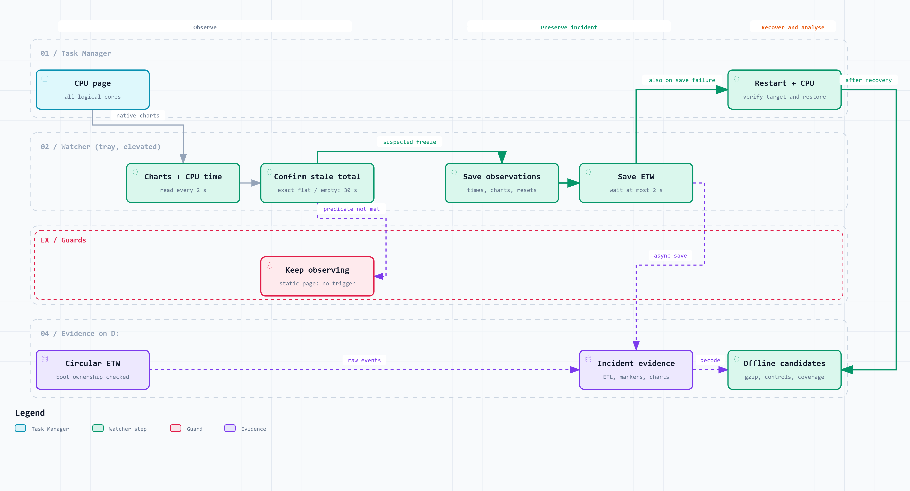
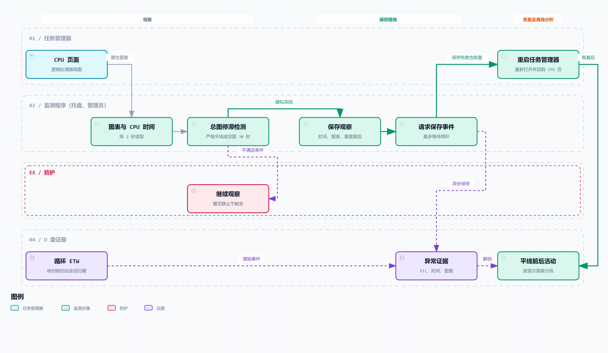

The English version governs.

<a id="en"></a>

**English** · [中文](#zh)

English is the controlling version.

The English version governs.

# Task Manager automatic freeze capture

💡 Vote on Feedback Hub: If you are affected by this bug, please upvote the official report so it gets escalated faster: [aka.ms/AA13rk15](https://aka.ms/AA13rk15).

Personal Windows diagnostic extension of [ScreenWatcher](https://github.com/bigzeze/ScreenWatcher), based on commit `e10fcd2`. The original MIT license, source and icon attribution are retained. The automatic native chart capture, detector and dump workflow were added with Codex as an AI collaborator.
The original upstream README is kept unchanged as [`UPSTREAM-README.md`](UPSTREAM-README.md).

## Roadmap (25 October 2026)

The [roadmap](docs/roadmap.md) defines when the flatline problem counts as resolved, gives the status of each workstream, records a critical review of the work so far and lists the next actions in order. Its main finding: the detector flags a candidate only after the total line has been flat for 11–14 seconds, so the "before-first" analysis window lies inside the freeze rather than before it. Task Manager's own ETW provider `Microsoft.Windows.Taskmgr` reports failures with their HRESULT without a debugger; a probe now checks whether `0x8007139F` marks each freeze, before any pixel-based reanalysis.

## Native freeze error fast recovery (26 October 2026)

The watcher now consumes `Microsoft.Windows.Taskmgr` (`{2e635d8e-1107-4555-9319-32eeb895aaae}`) in real time via a dedicated Win32 ETW consumer (`RealtimeConsumer`). When `TaskManagerDataLayer.dll` reports `0x8007139F` on the currently monitored Task Manager process:
- **Fast recovery path (`native_fast`)**: The watcher checks whether the total CPU chart stays flat (`tail_spread == 0.0`) for at least 10 seconds following the native error. If corroborated, it immediately triggers incident preservation and recovery without waiting for the full 30-second visual threshold.
- **Uncorroborated guard**: If the chart continues fluctuating or does not stay flat for 10 seconds within 25 seconds of the native error, the signal is recorded as "Native error not corroborated visually" (`chart_not_flat_for_10s`) and no recovery is triggered.
- **Visual fallback and cross-check**: The 30-second visual flatline detector remains active as a safety net. Each incident records its trigger path (`native_fast`, `visual`, or `both`), native error timestamp, and visual corroboration duration in `event.json`, `observation.json`, and offline reports. Cooldown and deduplication rules ensure that repeat events on the same target trigger recovery only once.

## Native freeze signature recording (26 October 2026)

Lightweight incident recording now includes Task Manager's own TraceLogging provider `Microsoft.Windows.Taskmgr` (`{2e635d8e-1107-4555-9319-32eeb895aaae}`) at Level 2 (Error) alongside kernel process and thread start/exit events. Both providers are captured in a single unified circular ETW session using `logman -pf providers.guid` with the buffer size increased to 128 MB (providing over 2 hours of history, well above the 20-minute minimum requirement).

Offline incident analysis extracts the native signature and call chain:
- **Native error extraction**: Searches for the first `FallbackError` event with `module=TaskManagerDataLayer.dll` and `hresult=0x8007139F` within `[coverage_begin, confirmed]`. It records the exact QPC and UTC timestamps, thread ID, lead time relative to the first visually flagged flat candidate, and the full WIL call chain (source file, line number, failure type, and message) within 50 ms on the same thread.
- **Process and thread activity**: Calculates process and thread start counts in the 2-second window `[-2, 0)` seconds prior to the native error, started processes' parent-child chains, and top thread-creating processes. It compares these against baseline statistics (median and maximum) computed across fifty 2-second control windows in `[-120, -20)` seconds prior to the error.
- **Missing reason accounting**: If no native error is detected, the report states "No native freeze signature recorded" with explicit categorization: `uncovered` (recording began after the incident), `blind` (incident occurred during an inactive/blind monitoring interval), or `not_present` (events fully covered but no `0x8007139F` found).
- **Automated N1 tally**: Incidents automatically evaluate the N1 qualification criteria (`conforming`, `non_conforming`, or `indeterminate`) and accumulate the running count in `n1-summary.json` and `status.json`.

## Post-recovery navigation retry and blind monitoring (26 October 2026)

When Task Manager is restarted following an incident, a failed initial navigation attempt (e.g. `cpu-not-found` while the WinUI 3 XAML island initialises) previously left the watcher in an indefinite `waiting` state once the initial 3 retries were exhausted. Because the CPU page was missing, monitoring was effectively blind (as observed in incident `restart-20261025-170806-531483`, where the watcher remained in `waiting` for 22.5 hours until manual page re-selection revealed a flatline already at 71/71 pixels). This operational gap is resolved:

- **Navigation-only retries with exponential backoff**: After `retry_exhausted` is flagged on `restarted_waiting_for_cpu_page`, the watcher schedules background navigation retries without restarting Task Manager again. The retry schedule follows an exponential backoff (`120s, 300s, 600s, 1200s, 1800s`, continuing at 1800s) capped at a maximum of 4 retries per rolling 60-minute window. Retries are guarded: if the target Task Manager process has exited or its PID changed, retries stop immediately.
- **User non-interference guard**: The watcher inspects whether the target Task Manager is the active foreground window and checks whether the user has interacted with the system in the last 10 seconds (`GetLastInputInfo` idle time < 10000 ms). If the user is actively working with Task Manager, the navigation retry is deferred by 60 seconds rather than stealing focus or overriding user page choices.
- **Visible blind monitoring in tray and status**: `status.json` now exposes `waiting_since`, `blind_seconds`, `blind_after_recovery`, and `next_navigation_retry`. When the watcher remains in `waiting` for 300 seconds (5 minutes) or longer, the status window text displays "Monitoring inactive" ("监测失效") and the tray icon tooltip alerts "Monitoring inactive (waiting for CPU page)" ("监测失效（等待 CPU 页面）").
- **Evidence audit and indeterminate onset in offline analysis**: Completed and ongoing blind periods are recorded in `Observations` and saved in `observation.json` as `blind_intervals` (stating start, end, duration, and reason `post_recovery_navigation_exhausted`). When an incident occurs after a blind interval, `incident-analysis.py` flags the onset as indeterminate (`freeze_onset_indeterminate: true`), suppresses using the blind interval as a normal control, and prepends an explicit bilingual warning in the incident analysis report.
- **Bounded failure diagnostics and navigation enhancement**: On navigation failure (exit code 2 or 3), `Restore-CpuPage.ps1` and `TaskmgrRecovery.py` save diagnostics to the incident folder: a bounded UI Automation tree (`navigation-uia-tree.json`, capped at 150 elements) and a Taskmgr-only window screenshot (`navigation-window.png`, capturing only the Task Manager HWND, strictly avoiding desktop or other windows). Furthermore, `Restore-CpuPage.ps1` now falls back to Win32 `FindWindowEx` when `.MainWindowHandle` is unavailable, adds localized CPU aliases (`中央处理器`, `Cpu`), and re-triggers the Performance navigation tab after 2.5 seconds if the CPU element is not immediately ready, mitigating race conditions during XAML island page routing.
- **Overview diagram rationale**: The high-level workflow architecture remains `Observe` -> `Preserve incident` -> `Recover and analyse`. The "Restart + CPU" node topology and evidence structure are preserved; navigation backoff retries and bounded diagnostics are internal reliability enhancements of that node, so the diagram in `docs/diagrams/` is kept unchanged.

## Offline analysis retry (25 October 2026)

A failed automatic analysis is now retried instead of left for manual work. A timeout, a snapshot still pending after 30 seconds, or an exit code other than 0 or 2 schedules up to two more attempts: the second after 60 seconds with a 300-second limit, the third after another 300 seconds with a 300-second limit (the first attempt keeps 120 seconds). Exit code 2 means the retained data cannot support a ranking and is final. Each retry reanalyses a verified copy in a new sibling directory `analysis-retry<n>-<incident>`, logs to `analysis-attempt<n>.log` in the incident folder and never replaces the original evidence or an earlier attempt. `analysis-status.json` shows `retry_pending` while waiting and finally lists every attempt; its `report` points to the successful directory. New incidents are queued (at most eight) and run before delayed retries, instead of being deferred while the decoder is busy. Retry copies count towards the ETW storage budget. Pending retries are not resumed after the watcher exits; a running attempt finishes within its limit. Trigger: on 24 October an analysis timed out after 120 seconds while all 32 logical processors were saturated; a manual rerun completed in 34 seconds once load fell. Detection and recovery are unchanged; the overview diagram is unchanged because the analysis step it shows is the same.

## Operational reliability and DLL baseline (25 October 2026)

Operational gaps in offline processing and startup/shutdown lifecycle are resolved:
- **Process tree termination via Job Object**: Each offline analysis attempt executes inside a dedicated Windows Job Object configured with `JOB_OBJECT_LIMIT_KILL_ON_JOB_CLOSE`. When an analysis times out or the watcher shuts down, the entire process tree—specifically child decoders such as `tracerpt.exe`—is terminated immediately, preventing runaway background decoders from writing to incident directories. Only watcher-spawned subprocesses are assigned to this job; Task Manager, debuggers, and external applications are never affected.
- **Queue capacity and cancellation audit**: Submitted incidents write `analysis-status.json` with status `queued` immediately upon enqueueing. Re-queued retries strictly respect the `MAX_QUEUED` (8) capacity bound; if the queue is full, the attempt is recorded as `deferred` along with explicit manual re-run instructions (`tools/process-incident.py <incident> --output <retry-folder>`). On graceful shutdown (`close()`), all unstarted and waiting items are transitioned to `cancelled` with manual re-run commands.
- **Stage classification and retry bounding**: Failures are classified by stage (`snapshot`, `decode`, `compress`, `analyze`, `timeout`), with reasons, stage durations and attempt history recorded. Retries are restricted to transient conditions (load timeouts, snapshot preparation delays, and decoder time bounds). Deterministic failures—including unusable rankings (exit code 2), decoder XML byte limit exhaustion, corrupt ETLs, or parse crashes—are never retried. For attempts 2 and 3, decoder timeouts are relaxed to 210 seconds within the 300-second attempt budget, while strictly enforcing the upper bound.
- **Shutdown synchronization and heartbeat confirmation**: The single-instance mutex is retained until background analysis threads and Job Objects have terminated completely, eliminating double-decoding race conditions upon restart. `Stop.ps1` requests a graceful stop and waits up to 25 seconds for the process to exit (verifying that `dump_running` is false before signaling; never killing forcibly). `Start.cmd` / `Start.ps1` detects existing instances via the mutex without silent exits, and confirms the new instance heartbeat in `status.json`.
- **Target DLL baseline tracking**: On watcher start, the SHA-256 digest, PE file version, and file modification time of `C:\Windows\System32\TaskManagerDataLayer.dll` are inspected and saved under `target_dll` in `status.json`. If the SHA-256 changes relative to the baseline, `dll_changed: true` is flagged in status for subsequent review without automated disassembly.

## Activity before and after first flat observation (20 October 2026)

New offline reports rank two phases independently: **before-first** is the short transition window `(last_normal, first_candidate)`; **after-first** is companion activity during `[first_candidate, confirmed]`. Events exactly at the first-flat boundary belong only to after-first. The boundary is a visual observation affected by sampling and display latency, not the native fault time. A later process must not become a before-first candidate just because it dominates the confirmation window.

Each phase includes its duration, event and unresolved counts, an independent Top 3, and a contiguous normal control ending at `last_normal`. Controls aim for that phase's duration; shorter controls retain their actual exposure and rates. Without a connected last-normal sample, before-first and the controls are unavailable; after-first uses `(first_candidate, confirmed]`. Missing required coverage or event loss still suppresses named ranks. No missing identities or controls are filled with invented zeroes.

JSON schema 2 adds `phases.before_first` and `phases.after_first`; the top-level `top` now contains **before-first only**, labelled by `top_scope`. Top-level `event_counts` still cover the whole observation window, as stated by `event_counts_scope`. Existing reports remain historical; use the existing offline analysis command with a new `--output` directory to reanalyse retained XML without replacing the originals. Future automatic offline subprocesses load this update without restarting the watcher. This changes analysis only; detection, recovery and the configured recording budget are unchanged.

## Evidence review and recording budget (20 October 2026)

The [consolidated evidence review](docs/investigation-status.md) separates the confirmed historical retry defect, the newer DLL's matching local control flow, and the still-missing same-incident buffer-to-freeze lineage. It corrects the fixed-4-KiB-reserve, inevitable-ghost, thread-death and process-crash claims. New-file static comparison does not authorise old debugger offsets or establish the cause of later visual recoveries. Earlier dated operation and validation entries below remain historical records.

The [21 October 2026 incident review](docs/flatline-incident-20261021.md) records a visual flatline with successful recovery, real-kernel and controlled 9549 query results, and a re-read of the fifteen 9549 address signatures. That incident does not by itself establish the native cause.

Lightweight recording now reports `light_etw.storage` with retained bytes by file type, budget, free disk bytes, check time and `blocked_by` reasons. The existing status label distinguishes budget exhaustion from low disk space. The default budget remains 2 GiB; an explicit whole-number `--etw-budget-gib` from 2 to 64 is saved as `etw_budget_gib` in local preferences. After checking `dump_running: false`, stop gracefully and wait for `state: stopped` before using the following example. Subsequent launches retain the setting. No evidence is removed, and automatic recovery continues when recording is blocked.

```powershell
.\Start.cmd --light-etw --etw-budget-gib 4
```

Usage includes the existing `light-etw` and `restart-*` ETL/XML/compressed/partial files. It is a pre-arm snapshot, not a live disk meter or hard reservation; an active trace or decoder can exceed the soft budget. The 1 GiB minimum free-space guard and 64 MiB circular trace size are unchanged. Expanding the budget resumes future collection only; missing past events remain unavailable.

## Current operation and investigation closure (2026-10-13)

The confirmed retry-count defect in the investigated DLL build is ready for engineering escalation. The three evidence layers are binary control flow, execution of the original native function, and historical aggregation/frozen-state dumps. This closes the local defect investigation; the same-incident buffer-to-freeze address lineage remains unobserved. It is not a Microsoft confirmation or a Windows fix. Live address-chain collection is retired for this investigation; the diagnostic tools and older instructions below are retained for reproducibility, not as a request to resume collection.

This workstation now uses the saved **Restart only, no evidence** preference with `Start.cmd`: after 30 seconds of a flat total curve while logical graphs move, restart Task Manager and restore its CPU page. No ProcDump/cdb origin monitor is attached in this mode. Autostart is unchanged. The current policy supersedes the historical capture-mode and validation descriptions below; the program still supports evidence mode if deliberately selected.

### Lightweight incident recording update

The preceding paragraph describes the earlier restart-only baseline. Optional **light event recording** now adds a separate 64 MiB circular process/thread ETW session to that recovery mode. It uses the existing Microsoft `logman`/`tracerpt` workflow, without Taskmgr breakpoints, injection, command-line collection or stress load. The byte limit does **not** guarantee a fixed history duration. No unique triggering application has been proved.

After checking that `D:\TaskmgrFreezeCaptures\status.json` has `dump_running: false`, stop the watcher with `Stop.ps1` and wait for its `state: stopped`, then run `Start.cmd --light-etw`. Keep restart-only recovery selected; with this option its label becomes **Auto recover, no dumps**. The option is saved in `.local/preferences.ini`, so later `Start.cmd` launches retain it. To disable it, stop gracefully and restart with `Start.cmd --no-light-etw`. Logon autostart is unchanged. The existing status window shows recording errors; `status.json` includes `light_etw` and `incident_analysis` details. No new interface or background service is installed.

Light recording locks the watcher to automatic recovery without dumps; disable the option before selecting the historical capture mode. The tray's **Open latest candidate report** item opens the latest available local report and is disabled until one exists.

A fresh post-stop process snapshot identifies surviving parents after the circular file wraps; a missing snapshot leaves those identities unknown. Creation times must match exactly to merge identities, so differences in timestamp precision can reduce coverage. Candidate JSON also includes the largest direct-child birth count within any 10 ms interval inside the observation window; this is a burst metric, not the time or threshold of the Taskmgr failure.

On a visual trigger, `restart-…` gains `observation.json`, selected chart PNGs, `trace-capture.json` and `process-trace/` containing the stopped raw ETL, baseline process identities and session metadata. The in-memory chart history is bounded to 61 pairs. Markers cover the last normal sample, first flat candidate, confirmation and recovery; these are watcher observations, **not exact native failure times**. Before recovery the worker waits at most two seconds for ETW preservation; a late or failed save is recorded and recovery continues. The collector serialises stop/save/rearm and records the gap. Its own cleanup can take up to 25 seconds; unresolved previous ownership prevents starting a duplicate session.

After recovery, one bounded offline decoder produces `incident-analysis.json` and a bilingual `incident-analysis.md`, with at most three candidates ranked by direct child process starts, then own thread starts. Each row retains the process instance and parent chain; known monitor-related instances are tagged rather than removed by executable name. Reports include actual exposure, a contiguous visually normal control interval when available, unresolved identities, loss and coverage. Circular overwrite alone is allowed, but a missing required interval or lost events suppresses named rankings; overwritten identity history is not filled with a stale baseline. Parent chains are not call stacks. `analysis-status.json` records incomplete or deferred analysis, and the raw ETL remains available. Failed attempts are retried automatically; see the 25 October 2026 update.

For a retained incident, run the following locally; the first command decodes ETL and analyses it, the second only reanalyses existing XML into a new report folder:

```powershell
.\.venv\Scripts\python.exe tools\process-incident.py D:\TaskmgrFreezeCaptures\restart-<incident>
.\.venv\Scripts\python.exe tools\analyze-incident.py D:\TaskmgrFreezeCaptures\restart-<incident> --output .local\incident-review
```

Decoding retains the existing 90-second / 256 MiB XML bounds; the automatic job has a 120-second limit and defers a new report while another decoder is busy. New ETW sessions pause at a 2 GiB accumulated ETL/XML budget or less than 1 GiB free disk space; an already active circular trace or decoder can exceed that soft budget. Existing evidence is never automatically deleted. Failures preserve automatic recovery and are visible in the status files. CPU measurements must state which processes were measured; neither zero overhead nor a universal churn threshold is promised. Repeated incident/control comparisons and separately authorised application stop/start tests can strengthen a candidate; these events do not expose Taskmgr's NtQSI return values, buffer sizes, HRESULTs or a same-incident buffer-to-freeze chain.

### Long-session recovery update (14 October 2026)

Historical address-chain tests select only the pinned DLL hash, using the local Windows component store if the live DLL has changed. An unavailable fixture is reported as skipped, not as new-build validation; production hash/byte guards are unchanged. A changed DLL requires separate investigation before any old RVA or defect claim can be applied to it.

The earlier 256 MiB XML limit still applies to the historical debugger workflow. Lightweight incident decoding now uses a bounded **1 GiB temporary XML file**, checks at least 1.5 GiB free space before starting, and retains the complete decoded stream as lossless `events.xml.gz`. The 90-second decode/compression deadline and 120-second automatic-job deadline remain. The parser scans the complete stream, keeps all process lifetimes for identity resolution, and retains thread events in memory only for the observed/control interval. It records scanned/selected counts and refuses malformed, truncated or over-limit input. Raw ETL is unchanged; an existing failed attempt is preserved. Use `tools/process-incident.py <incident> --output <new-separate-directory>` to recover into a fresh directory with SHA-256-verified source copies and `provenance.json`. The report now shows normal child-start counts beside incident counts.

Visual continuity resets now retain their reason, recent history and the last disconnected normal observation. Reasons include a changed window/geometry, a missing CPU page, invalid chart data, capture timeout, sampling gap and recovery. A disconnected observation is background context only; it is never silently promoted to a continuous normal control. Older incidents lack this audit and cannot be repaired retrospectively.

At startup, an old running journal can be bypassed only when its creation predates the current Windows boot and a read-only query of its exact UUID session reports that it is absent. The old journal and ETL remain unchanged, and `ownership-resolution.json` records the verification. A same-boot, active, malformed or access-denied session remains unresolved; the watcher never stops it by guessing its owner. The cumulative soft storage budget includes compressed and partial outputs. These checks use the existing [Microsoft tracerpt](https://learn.microsoft.com/en-us/windows-server/administration/windows-commands/tracerpt) and [ControlTraceW query API](https://learn.microsoft.com/en-us/windows/win32/api/evntrace/nf-evntrace-controltracew).

<picture>
  <source media="(prefers-color-scheme: dark)" srcset="docs/diagrams/overview.en.dark.png">
  
</picture>
<!-- Earlier restart-only diagram caption: Current restart-only workflow: read native CPU charts every 2 seconds, confirm a flat total curve with moving logical graphs for 30 seconds, verify Taskmgr, restart it and restore the CPU page; retain an event.json receipt, without debugger attachment or dumps. -->
<!-- Historical capture-mode caption retained with the earlier operation records: Workflow diagram: the watcher reads Task Manager's native CPU charts every 2 seconds; the freeze detector fires when the total curve stays flat for 30 seconds while the logical-processor curves keep moving, otherwise nothing is captured; after the target is confirmed as System32\Taskmgr.exe, ProcDump writes two full dumps to TaskmgrFreezeCaptures on D:; only when both dumps are valid is Task Manager restarted and returned to the CPU page, and a failed dump or the storage limit means no restart. -->

## Operation

- `Install.cmd`: one administrator approval installs the `TaskmgrFlatlineWatch` scheduled task, starts it immediately, and starts it automatically 15 seconds after this user logs in.
- `Start.cmd`: run manually with administrator approval, without installing a scheduled task.
- The tray menu provides status and exit. Closing the status window hides it; it does not stop monitoring.
- Logon autostart switch: the **Start at logon** item in the tray menu and the checkbox in the status window, or `Autostart.cmd on|off|status` (asks for administrator approval to change). It only enables or disables the registered task; the running watcher keeps running, and `Start.cmd` still works when autostart is off. Autostart was switched off on 2026-10-04.
- Restart-only mode: **Restart only, no evidence** in the tray menu or the status window (saved across restarts). After the same 30-second confirmation, Task Manager is restarted directly: no graph PNGs, no dumps, and no origin monitor; attached debuggers are detached gracefully when the mode is switched on. Each restart leaves only `restart-YYYYMMDD-HHMMSS-ffffff\event.json` on D: (time, PID, restart result). A failed restart is retried as before, and the same-window cooldown is 60 seconds instead of ten minutes.
- `Stop.ps1`: stop this running watcher gracefully. `Uninstall-Autostart.ps1`: remove only this installation's scheduled task and stop the watcher. Evidence is retained.
- For a fresh checkout, install Python 3.12 and run `Setup.cmd`. Dependencies are pinned in `requirements-flatline.txt`. Setup downloads Microsoft's signed ProcDump from the official Sysinternals site and checks its signature. ProcDump is not redistributed in Git.

## Automatic detection

Update 2026-10-23: CPU-page recognition now accepts logical-chart widths differing by one pixel without rounding them into fixed buckets. A 32-chart layout with 24 widths of 101 pixels and eight of 102 pixels previously stayed in `waiting`, preventing confirmation and recovery. The complete logical-processor count and 80% width-agreement guard remain; agreement now means one adjacent pair of integer widths. The 30-second freeze predicate is unchanged.

Validation on 23 October: 127 tests and `compileall` passed. The unchanged live window was recognised after the fix; the restarted watcher confirmed the flat aggregate in 30.4 seconds and automatically recovered Task Manager without forced termination. CPU-page navigation succeeded on its second attempt, normal sampling resumed with 32 charts, and lightweight recording continued. The receipt is `restart-20261023-180302-722186/event.json` in the existing evidence directory. This verifies recovery of the visual incident, not its underlying Windows cause.

Update 2026-10-19: the one-pixel tolerance described below is retired. A non-empty aggregate now requires zero vertical spread in its newest 20% and exactly the same pixel height throughout the 30-second confirmation. Any one-pixel wave or level change restarts confirmation, preventing the observed low-load false positive. Empty-chart corroboration is unchanged. Truly constant load can still satisfy a visual-only predicate; slight rendering noise may delay recovery.

Update 2026-10-16: a zero/empty aggregate chart previously returned `invalid` because it contained no blue curve, so confirmation never started. The additional empty-chart path requires a visibly painted frame on all four sides, a uniform neutral interior, moving logical graphs, and independent CPU-time activity of at least 2% throughout the 30-second confirmation. A borderless blank capture, unavailable CPU sample, low activity or a capture gap resets this path. Each existing capture-helper sample reads [GetSystemTimes](https://learn.microsoft.com/en-us/windows/win32/api/processthreadsapi/nf-processthreadsapi-getsystemtimes); no additional process, debugger, stress load or performance-counter configuration is needed. The first sample establishes a baseline. Above 64 logical processors this corroboration is disabled because that API covers only the caller's processor group. Status and incident measurements include the detector kind and independent CPU percentage. This is a suspected display inconsistency, not proof that this incident shares the historical DLL defect or that a particular application caused it.

Update 2026-10-01: the ten-minute cooldown now applies only to repeated captures of the same PID and window. A replacement Task Manager that freezes again receives a new dump pair and recovery after the 30-second visual confirmation, without waiting for the previous process's cooldown. A blocked capture shows the cooldown and remaining seconds. Fourteen tests pass, including replacement-process recovery eligibility and cooldown persistence across watcher restarts.

Every two seconds a separate helper enumerates Task Manager's native `CvChartWindow` controls. It identifies the leftmost top CPU thumbnail and a complete logical-processor graph grid matching the machine's logical processor count. `PrintWindow` reads those controls directly; no manual region selection, OCR, screenshot of other applications, or upload is involved. Read operations time out after eight seconds by terminating only our own helper.

The newest 20% of the aggregate curve must remain horizontal at the same pixel height for 30 seconds, while logical graphs continue changing. The detector uses a one-pixel tolerance. It reports a **suspected** freeze: genuinely constant total load can also satisfy this visual test. A static entire page does not trigger a dump. Ten seconds of changing aggregate curves rearm detection. A ten-minute capture cooldown also applies.

Task Manager must be running on **Performance → CPU → Logical processors**, with its chart controls rendered. Covered windows can be captured directly; minimized windows, another page, or a closed Task Manager cause the watcher to wait. After two fault dumps pass validation, it closes only the captured Task Manager (with a targeted termination fallback if closing times out), relaunches it and uses bounded UI Automation in an STA PowerShell process to return to Performance / CPU. It verifies the logical graph grid before reporting recovery. Windows itself is never restarted. Ordinary installation verification does not restart Task Manager; an explicitly requested recovery verification exercises that path separately. Display layout changes are rediscovered automatically. The current color detector recognizes blue/cyan CPU plots; unsupported contrast themes can be reported as unrecognized.

## Evidence on D:

All evidence stays in `D:\TaskmgrFreezeCaptures\YYYYMMDD-HHMMSS-ffffff`:

- Two full Task Manager dumps, using `procdump64 -r -ma`, with five seconds between completion of the first and starting the second.
- Aggregate and logical graph PNGs from the in-memory history, at up to three time points.
- `event.json`: detector measurements, timestamps, PID, rectangles and actual dump success/failure.
- ProcDump output logs. `D:\TaskmgrFreezeCaptures\status.json` records current watcher state; its timestamp matters if the process has stopped.

The target executable is verified as Windows `System32\Taskmgr.exe` before each dump. The original window identity is also checked. Dump failures are recorded, not presented as successful captures. No Defender setting, driver, CPU setting or performance counter configuration is changed.

New dumps pause if D: has less than 10 GiB free or existing dumps exceed 50 GiB. One active capture can exceed that soft limit. Existing evidence is never automatically deleted. The history ring holds only 31 pairs of graph images; it does not record the desktop continuously. Exiting during an active dump allows the current capture thread to finish.

## Origin monitor and query trace

Each Task Manager instance gets one debugger. By default ProcDump waits for the first `0x8007139F` aggregation report and writes one full dump to `origin-YYYYMMDD-HHMMSS-PID`. It is detached with `procdump -cancel`, never terminated.

`Start.cmd --query-trace` replaces ProcDump with cdb (WinDbg) for each instance, in `origin-…-PID-trace`. Logging breakpoints in `QueryProcessInformation` record every NtQSI status and buffer length, flag queries whose three attempts all failed but still returned success, and walk the last record of each such buffer. At the first `0x8007139F` report it writes `Taskmgr-origin.dmp` and detaches. `query-trace.jsonl` lists third-call successes, exhausted retries and other errors, and `origin.json` holds the counts. The offsets are valid only for `TaskManagerDataLayer.dll` with SHA-256 `829263f5…5dce`. A different file hash, or different code in memory, means no breakpoint is set and ProcDump is used instead. The breakpoints widen the gap between NtQSI calls, so counts are not natural failure rates. Detach clears breakpoints, resumes for one second, then quits with `qd`. Detaching directly with breakpoints set killed a test process with `0x80000003`. The status window shows **Query trace** while this mode is on.

## Address provenance capture (opt-in)

Historical procedure, retired from the current investigation on 2026-10-13. Do not run another 20–60 minute session as part of this closeout.

`tools/capture-address-chain.py --pid <current PID> --minutes 20 --output D:/TaskmgrFreezeCaptures/address-chain-<unique name>` runs with `.venv/Scripts/python.exe` in an administrator terminal. The output folder must be new and contain no spaces. It verifies the Taskmgr image, process creation time, DLL hash and breakpoint instructions, stops the existing watcher through `Stop.ps1`, and restores its previous mode only after the debugger has exited and detached. It refuses to stop an active dump. No saved preference, autostart or system setting is changed. Creating `stop.request` inside that capture folder requests an early graceful detach.

An exhausted query receives an instance-specific query ID and a saved raw buffer. Only then are sparse address-conditioned breakpoints enabled: `ConvertFrom`, native copy/move/assignment entry and return, destructor/default construction, buffer disposal, cache swaps, vector publication and the exact Idle conflict branch at RVA `0x3E5CF`. The collector records completed source-to-destination operations and retires destroyed or overwritten addresses; equal PID/CreateTime fields alone never establish provenance. Unknown paths, malformed memory or exhausted bounds end that attempt as incomplete. Detailed tracing is limited to 120 seconds, 32 live tracked objects and 4,096 events; raw buffers to 8 MiB and the cdb log to 50 MiB. The overall capture defaults to 20 minutes (maximum 60).

At the precise conflict it saves a full dump and detaches using the existing two-stage handshake. The chart detector starts a fresh observation window after detach. A subsequent 30-second flat total graph with moving logical graphs saves PNGs and another dump. The original watcher is then restored, including after an incomplete attempt; an attached debugger prevents that restoration. This diagnostic temporarily suspends automatic recovery and changes timing. Captured counts are not natural failure rates.

Run `tools/audit-address-chain.py <capture folder>` with Python to rebuild the address lineage from operations and lifetimes, check raw-buffer hashes and the conflict dump, and write `audit.json` and `address-chain.tsv`. `address-events.jsonl`, `query-trace.jsonl`, `cdb.log`, generated scripts and the binary buffers are the retained raw evidence. A successful address audit does not itself prove the update task stopped: independently inspect the conflict and post-freeze dumps. The tool deliberately keeps overall acceptance incomplete until that separate investigation is documented. Historical report packages are not changed automatically.

### Process and thread correlation

Current offline analysis uses **Top Delta**: `tools/correlate-process-trace.py <capture folder> --lookback-ms 10 --output <new report folder>`. It writes `thread-top-delta.tsv` and `thread-top-delta.json`, with at most three process instances per abnormal query, ranked by **Thread Start Count** in the inclusive 0–10 ms window before the final NtQSI return marker is received. `--lookback-ms` accepts a positive value up to 10; rates are counts divided by that window. Each row retains PID, creation time, image path (or available name), query kind and raw QPC boundaries. Unresolved identities are counted separately, never combined into a named creator; event loss suppresses rankings and incomplete query coverage is reported. Historical reports are not overwritten.

These are debugger-host receipt times with unbounded, unmeasured transport latency, not microsecond-accurate target execution times. Thread-start counts are neither net snapshot growth nor proof of responsibility, and no universal churn threshold is claimed. The 8 October trace replays to 12 ranked rows across 15 covered abnormal queries, all `third_success`; it contains no three-failure/S_OK query. No new live trace or stress test is required. The former `--margin-ms` interface and broad candidate output described below apply only to the historical analyser through 2026-10-08.

Data loss or circular overwrite risk suppresses named candidate output. Failed session stop is retried three times; if all fail, stop only the session named in `process-trace/session.json` with `logman stop <saved session name> -ets` from an administrator terminal.

Add `--process-events` to the address-capture command to record process/thread creation and exit with the inbox Microsoft `logman` and `tracerpt` tools. This creates a uniquely named temporary ETW session, records an initial process-path/parent/creation-time snapshot, and stops only its own session. It does not collect command lines or change system logging settings. The circular ETL is limited to 64 MiB; offline XML decoding is limited to 90 seconds and 256 MiB. Raw ETL, scripts, logs and session ownership are retained in `process-trace/`. If cleanup fails, `capture.json` records the error and whether that named session may still be active.

Run `tools/correlate-process-trace.py <capture folder>` after collection. `process-candidates.tsv` lists process identities, paths, parent PIDs and process/thread changes around each abnormal query; `process-correlation.json` retains matching events and data-loss checks. PID reuse is separated by creation time and observed lifetime; unavailable identities stay unresolved. ETW events and query receipts use raw QueryPerformanceCounter ticks, avoiding rendered-timezone ambiguity. Query timestamps are debugger-host receipt times, with no measured latency bound. The default 100 ms margin (adjustable with `--margin-ms`, 0–1000) is only a search heuristic; rows distinguish events inside the receipt window from margin-only events. These are temporal candidates, not proved buffer contributors or responsible applications. Repeated controlled comparisons and the same-incident address chain are still required. Lost events, circular overwrite risk, decode errors and missing coverage are reported explicitly.

## Validation and limitations

Run `tools\ci-local.ps1` for detector tests and syntax checks. Twelve tests pass, covering moving curves, whole-page freezing, flat aggregate with moving cores, changing flat levels, capture gaps, invalid images, rearming, rejecting non-Taskmgr targets, capture orchestration with a mocked dump writer, and restart guards for failed/missing dumps and ordinary installation verification. The mocked test does not validate actual memory dumping. Native capture was exercised against this machine's Windows 11 Task Manager and its 32 charts. Administrator installation completed on 2026-09-29. The scheduled task is running with highest privileges and a 15-second user-logon trigger. Two real full-memory dumps (617,323,753 and 617,434,233 bytes) were written automatically during an explicitly labeled installation verification in `D:\TaskmgrFreezeCaptures\verification-20260929-221333-404379`. Their stream directories and full-memory payload bounds were validated. ProcDump 12.01 returned 1 with successful completion logs; the watcher now requires both a completion log and valid dump structure rather than assuming exit code zero. The earlier verification and its initially incorrect failure status are retained with independent validation results. The installation verification bypassed the freeze predicate. The first real automatic freeze capture completed on 2026-09-30 at 12:11 BST, in `D:\TaskmgrFreezeCaptures\20260930-121116-389740`, with two valid full dumps (655,868,739 and 657,822,657 bytes). Recovery was added after this event; that original PID had already exited before the update, so it was not restarted using the old evidence. On 2026-09-30, the complete recovery verification `verification-20260930-122010-037103` saved two validated dumps, gracefully restarted Task Manager from PID 9804 to 95956, restored the CPU logical-processor page, and resumed normal sampling of all 32 charts. The logon configuration was inspected and the scheduled task started successfully, but no reboot/logon test has been performed. This detector records evidence; it does not establish or fix the underlying Windows bug.

Sources: [Microsoft ProcDump documentation](https://learn.microsoft.com/en-us/sysinternals/downloads/procdump), [Microsoft PrintWindow documentation](https://learn.microsoft.com/en-us/windows/win32/api/winuser/nf-winuser-printwindow). Python dependencies retain their own licenses; the installed distributions contain their license texts.

---

<a id="zh"></a>

[English](#en) · **中文**

以英文为准。

# 任务管理器自动冻结取证

💡 反馈中心投票：如果你也遇到了该问题，请在 Windows 反馈中心点赞支持以加快官方排期修复：[aka.ms/AA13rk15](https://aka.ms/AA13rk15)。

这是个人 Windows 诊断工具，基于 [ScreenWatcher](https://github.com/bigzeze/ScreenWatcher) 的 `e10fcd2` 提交扩展。保留上游 MIT 许可、源码和图标归属。原生图表自动抓取、异常判定和转储流程由 Codex 作为 AI 协作贡献者参与实现。
上游原 README 原样保留为 [`UPSTREAM-README.md`](UPSTREAM-README.md)。

## 路线图（2026-10-25）

[路线图](docs/roadmap.md#zh)规定平线问题怎样算解决，列出各工作线现状、对已有工作的批判性审查和按顺序的下一步行动。主要发现：检测器在总图已平 11–14 秒后才判为候选，因此"平线前"分析窗口落在冻结期内，而不是冻结之前。任务管理器自带的 ETW 提供程序 `Microsoft.Windows.Taskmgr` 无需调试器即可报告带 HRESULT 的故障；现在先用探测会话检验每次冻结是否都伴随 `0x8007139F`，再决定是否做基于像素的重新分析。

## 原生错误触发快速恢复（2026年10月26日）

监测器现通过专用的 Win32 实时 ETW 消费者（`RealtimeConsumer`）实时监听 `Microsoft.Windows.Taskmgr`（`{2e635d8e-1107-4555-9319-32eeb895aaae}`）。当当前被监测的任务管理器进程中 `TaskManagerDataLayer.dll` 报出 `0x8007139F` 错误时：
- **快速恢复路径（`native_fast`）**：监测器检验总 CPU 图表在原生错误发生后是否保持平直（`tail_spread == 0.0`）至少 10 秒。若得到视觉印证，立即触发事件留存与自动恢复，无需等待满 30 秒视觉阈值。
- **未印证防误触发守卫**：若原生错误发生后图表仍在波动或在 25 秒内未能满足连续 10 秒平直，该信号记录为“原生信号未得到视觉印证”（`chart_not_flat_for_10s`），不触发恢复。
- **视觉兜底与交叉核对**：原有的 30 秒视觉平线检测完整保留作为兜底安全网。每次事件在 `event.json`、`observation.json` 与离线分析报告中记录具体触发方式（`native_fast`、`visual` 或 `both`）、原生事件时间及视觉印证时长。冷却机制与防重复设计确保同一目标上的重复事件只恢复一次。

## 原生卡死特征记录（2026年10月26日）

轻量异常记录现已将任务管理器自身的 TraceLogging 提供程序 `Microsoft.Windows.Taskmgr`（`{2e635d8e-1107-4555-9319-32eeb895aaae}`，错误级 Level 2）与内核进程／线程启停事件合并到同一个循环 ETW 会话中，通过 `logman -pf providers.guid` 统一调度。缓冲区上限提升至 128 MB，可保留超过 2 小时的历史记录，远超 20 分钟覆盖底线。

离线分析新增原生特征与调用链提取：
- **原生错误提取**：在 `[覆盖起点, 确认]` 观察窗口内查找第一条来自 `TaskManagerDataLayer.dll` 且 `hresult=0x8007139F` 的 `FallbackError` 事件。记录精确的 QPC 与 UTC 时间戳、线程 ID、相对首次视觉候选的提前量，以及同线程 50 毫秒内的完整 WIL 调用链（源文件名、行号、failureType 与错误消息）。
- **进程与线程增减分析**：统计原生错误发生前 2 秒区间 `[-2, 0)` 内的进程与线程启动数、新启动进程的父子链与主要线程创建者，并与该错误前 `[-120, -20)` 秒内 50 个 2 秒对照窗口的中位数和最大值进行对比。
- **缺失原因核算**：若未记录到原生错误，报告明确注明“未记录到原生卡死特征”并区分具体原因：`uncovered`（事件前覆盖时长不足）、`blind`（发生在失明监测期间）或 `not_present`（完整覆盖但确实未出现该错误）。
- **自动累计 N1 判定**：每次事件自动判定是否符合 N1 准则（符合 `conforming`、不符合 `non_conforming` 或原因不可判定 `indeterminate`），并在 `n1-summary.json` 和 `status.json` 中累计历史计数。

## 恢复后导航重试与失明监测（2026 年 10 月 26 日）

任务管理器在故障恢复重启后，若初始导航失败（例如 WinUI 3 XAML 孤岛加载竞争导致 `cpu-not-found`），此前的监测器在 3 次初级重试用尽后会无限期停留在 `waiting` 状态。因未切回 CPU 页面，监测实际上处于失明状态（如 `restart-20261025-170806-531483` 事件中监测器在 `waiting` 持续约 22.5 小时，直到人工切页才发现总图已平满 71/71 像素并再次恢复）。现已解决该运行缺口：

- **只导航不重启的指数退避重试**：在状态为 `restarted_waiting_for_cpu_page` 且 `retry_exhausted` 后，监测器安排后台只导航重试，绝不重复重启任务管理器。重试采用指数退避（120 秒、300 秒、600 秒、1200 秒、1800 秒，之后每 1800 秒），并设每 60 分钟最多重试 4 次的上限防护。重试具备存活守卫：若目标 PID 已退出或 PID 变更，立即停止重试。
- **避免干扰前台用户**：重试前检查目标任务管理器是否处于前台，并核对用户在最近 10 秒内是否有系统输入操作（`GetLastInputInfo` 空闲时间 < 10000 毫秒）。若用户正在与任务管理器交互，本次导航自动推迟 60 秒，绝不抢占焦点或强行覆盖用户的切页操作。
- **托盘与状态可见的失明状态**：`status.json` 新增 `waiting_since`、`blind_seconds`、`blind_after_recovery` 与 `next_navigation_retry` 字段。当监测器处于 `waiting` 达到或超过 300 秒（5 分钟）时，状态窗口显示「监测失效」（英文 "Monitoring inactive"），托盘图标悬浮提示显示「监测失效（等待 CPU 页面）」（英文 "Monitoring inactive (waiting for CPU page)"）。
- **失明区间存入证据与离线分析判定**：完成或正在进行的失明时段记录进 `Observations`，并在 `observation.json` 中保存为 `blind_intervals`（记录起止时间、秒数及原因 `post_recovery_navigation_exhausted`）。若在失明区间后发生冻结事件，离线分析标记起点不可判定（`freeze_onset_indeterminate: true`），禁止将失明期作为正常对照，并在双语离线报告开头加入明确警示。
- **有上限的失败诊断与导航定位增强**：导航失败时（退出码 2 或 3），`Restore-CpuPage.ps1` 与 `TaskmgrRecovery.py` 在事件目录留存有上限的诊断：UIA 树摘要（`navigation-uia-tree.json`，最多 150 个元素）与仅包含任务管理器窗口的截图（`navigation-window.png`，仅抓取目标 HWND，绝不截取桌面或其他窗口）。同时增强了 `Restore-CpuPage.ps1`：在 `.MainWindowHandle` 无效时以 Win32 `FindWindowEx` 兜底查找窗口，补充本地化 CPU 别名（`中央处理器`、`Cpu`），并在 2.5 秒后重新激活性能选项卡以消除 XAML 页面初始路由时差。
- **总览流程图不改动理由**：顶层工作流架构仍为 `Observe` -> `Preserve incident` -> `Recover and analyse`。图中的“重启 + CPU”节点拓扑与证据结构未变，退避重试与失败诊断属于该节点内部的可靠性强化，因此 `docs/diagrams/` 流程图保持不变。

## 离线分析自动重试（2026-10-25）

自动分析失败后不再只留给手动处理。超时、等待 30 秒后 ETW 快照仍未保存，或退出码不是 0 或 2，都会再安排至多两次：第二次在 60 秒后、限时 300 秒，第三次再过 300 秒、限时 300 秒（第一次仍限时 120 秒）。退出码 2 表示保留的数据无法支持排行，不再重试。每次重试都把校验过的副本放进新的同级目录 `analysis-retry<n>-<事件目录>` 重新分析，日志写入事件目录下的 `analysis-attempt<n>.log`，不覆盖原始证据或之前的尝试。等待期间 `analysis-status.json` 显示 `retry_pending`，结束后列出每次尝试，`report` 指向成功的目录。解码器忙时，新事件改为排队（最多八个）并优先于延迟中的重试，不再标记为推迟。重试副本计入 ETW 存储预算。监测器退出后不再续跑待重试项；正在进行的尝试会在时限内结束。起因：10 月 24 日 32 个逻辑处理器全部满载时，一次分析在 120 秒时超时；负载回落后手动重跑 34 秒完成。检测与恢复不变；总览图展示的分析步骤没有变化，因此未改图。

## 运行可靠性与 DLL 基线（2026-10-25）

离线分析与起停生命周期中的运行缺口现已修复：
- **作业对象结束进程树**：每次离线分析尝试均放进配置了 `JOB_OBJECT_LIMIT_KILL_ON_JOB_CLOSE` 的专用 Windows 作业对象（Job Object）。分析超时或监测器退出时，整个进程树（尤其是 `tracerpt.exe` 等子解码器）会被彻底结束，防止失控的子进程继续向事件目录写入。作业对象仅接管监测器启动的进程，绝不影响任务管理器、调试器或系统外部进程。
- **队列容量与退出取消审计**：新事件提交时立即写入 `analysis-status.json`（状态为 `queued`）。重试重新入队严格受 `MAX_QUEUED`（8项）容量限制；队列满额时记录为 `deferred` 并附带具体的人工重跑命令（`tools/process-incident.py <事件目录> --output <新目录>`）。正常停止（`close()`）时，所有未开始和等待重试的项目全部改写为 `cancelled` 并记录人工重跑命令。
- **阶段化错误分类与确定性失败防重试**：失败按阶段细分为快照未就绪（`snapshot`）、解码（`decode`）、压缩（`compress`）、分析（`analyze`）与超时（`timeout`），并在状态中记录阶段名称、详细原因及各阶段耗时。重试仅限于暂时性故障（负载超时、快照等待、解码超时）；确定性失败（包括数据无法支持排行的退出码 2、XML 字节超限、损坏的 ETL 或解析崩溃）绝不重试。第 2、3 次尝试在 300 秒总体限时内将解码时限放宽至 210 秒，并严格保留时限防线。
- **退出时序屏障与启动心跳核对**：单实例互斥量严格在分析线程及作业对象完全结束之后释放，杜绝旧进程退出期间新实例并发解码。`Stop.ps1` 在确认 `dump_running` 为 false 后发起正常停止，并等待至多 25 秒确认进程退出（超时如实提示，绝不强杀）；`Start.cmd` / `Start.ps1` 启动前通过互斥量检测已有实例避免静默退出，并在启动后核对 `status.json` 新心跳才返回成功。
- **目标 DLL 基线记录与变更标记**：监测器启动时读取 `C:\Windows\System32\TaskManagerDataLayer.dll` 的 SHA-256 哈希、PE 文件版本及修改时间，写入 `status.json` 的 `target_dll` 字段。若哈希相对基线发生改变，在状态中标记 `dll_changed: true` 供人工审查，不自动触发静态反汇编。

## 首次平线前后活动（2026-10-20）

新版离线报告分两段独立排行：**平线前**是最后正常观察到首次平线之间的短暂转变窗口 `(last_normal, first_candidate)`；**平线后**是等待确认期间的伴随活动 `[first_candidate, confirmed]`。恰在首次平线边界的事件只计入后段。边界是受采样与界面延迟影响的视觉观察，不是底层故障时刻。晚出现的进程不会因为确认期间活动较多而成为平线前候选。

每段分别给出时长、事件数、未解析计数、独立前三名，以及以最后正常观察为终点的连续正常对照。对照尽量等长；时长不足时保留实际时长和每秒速率。没有连续的最后正常样本时，平线前和正常对照不可用，后段使用 `(first_candidate, confirmed]`。所需覆盖缺失或丢事件仍禁止具名排行；缺失身份或对照不会补成虚构的零。

JSON schema 2 新增 `phases.before_first` 和 `phases.after_first`；顶层 `top` 现在**仅含平线前**，由 `top_scope` 标明。顶层 `event_counts` 仍覆盖整个观察窗口，由 `event_counts_scope` 说明。旧报告作为历史保留；用已有离线分析命令的 `--output` 指定新目录即可重算已有 XML，不覆盖原件。后续自动离线子进程会加载更新，无需重启监测器。本次只改变分析，检测、恢复和已配置记录预算不变。

## 证据复核与记录预算（2026-10-20）

[统一证据摘要](docs/investigation-status.md#zh)区分历史已证实的重试缺陷、新 DLL 相同的局部控制流，以及尚未捕获的同次缓冲区到冻结完整来源链。它纠正固定 4 KiB 余量、必然假记录、线程死亡和进程崩溃等说法。新版静态比对不允许沿用旧调试地址，也不能证明后续视觉恢复的原因。下方较早日期的运行和验证内容作为历史记录保留。

[2026 年 10 月 21 日事件复核](docs/flatline-incident-20261021.md#zh)记录了一次视觉平线及成功恢复、9549 真实内核与受控查询结果，以及 15 处 9549 地址特征的重读核对。该事件本身不能证明原生成因。

轻量记录新增结构化存储状态，包含按文件类型统计的保留字节、预算、磁盘可用空间、检查时间及阻断原因；现有状态标签区分预算耗尽与磁盘空间不足。默认预算仍为 2 GiB，可通过英文区命令中的参数显式指定 2～64 GiB 整数值，保存到本地偏好。确认无取证任务后正常停止，等到状态为已停止，再启动；后续启动沿用该设置。不会删除证据，记录阻断时自动恢复继续工作。

统计继续包含现有轻量记录目录和重启事件目录中的 ETL、XML、压缩及部分文件。数值是布防前快照，并非实时磁盘仪表或硬性空间预留；已运行的记录或解码可以超过软预算。至少 1 GiB 可用空间检查与 64 MiB 循环文件大小不变。扩容仅恢复之后的采集，无法补回过去漏采的事件。

## 当前运行与调查结案（2026-10-13）

所查 DLL 版本的重试计数缺陷已证实，可以提交工程升级处理。三层证据包括二进制控制流、原生函数机器码执行结果，以及历史聚合错误／冻结状态转储。本地缺陷调查至此结案；同一现场从缓冲区到冻结的完整地址来源仍未观测到。这不代表微软确认或 Windows 已修复。本次调查结束活体地址链采集；下方旧工具与说明仅为保留可复现性，不是继续采集的要求。

本工作站现已保存「只重启，不取证」偏好，并用 `Start.cmd` 运行：总图平直且分线程图仍变化持续 30 秒后，重启任务管理器并恢复 CPU 页面。此模式不挂 ProcDump/cdb 首报监测，自启动设置不变。当前策略优先于下方保留的历史取证模式和验证记录；程序仍保留主动选择取证模式的能力。

### 轻量异常记录更新

上一段描述较早的只重启基线。现在可选用「轻量事件记录」，在自动恢复旁独立运行一个 64 MiB 的进程／线程 ETW 循环会话，复用微软 `logman`／`tracerpt`。不向 Taskmgr 设置断点或注入代码，不采集命令行，不制造压测负载。容量上限**不保证固定的历史秒数**，目前没有证明唯一的触发应用。

先检查 `D:\TaskmgrFreezeCaptures\status.json` 的 `dump_running` 为 `false`，通过 `Stop.ps1` 正常停止，等待状态变为 `stopped`，再运行 `Start.cmd --light-etw`。保持只重启恢复模式；此选项启用后，模式标签改为「自动恢复，不抓转储」。选项保存到 `.local/preferences.ini`，之后普通 `Start.cmd` 仍会启用。关闭时先正常停止，再以 `Start.cmd --no-light-etw` 启动。登录自启动设置不变。原有状态窗口显示采集错误，`status.json` 的 `light_etw` 和 `incident_analysis` 提供详情；不安装新的界面或后台服务。

轻量记录会锁定为不抓转储的自动恢复；如需选择历史取证模式，先关闭此选项。托盘的「打开最近候选报告」可打开已有的最新本地报告，报告尚未生成时不可点击。

停止后的新鲜进程快照用于确认循环覆盖之后仍存活的父进程；快照缺失时，相应身份保持未知。只合并创建时间完全一致的身份，因此时间精度差异可能减少可解析范围。候选 JSON 还列出观察窗口内任意 10 毫秒区间的最大直接子进程新建数；这是突发活动指标，不是 Taskmgr 故障时刻或触发阈值。

触发视觉异常后，`restart-…` 新增 `observation.json`、选定图表 PNG、`trace-capture.json` 和 `process-trace/` 下的已停止原始 ETL、初始进程身份及会话元数据。内存图表最多保留 61 对。记录最后正常样本、首次水平候选、确认和恢复时间；这些是监测器的观察，**不是底层故障的精确时刻**。恢复前最多等待 ETW 保存两秒，保存迟到或失败均会记录，恢复继续。采集器顺序执行停止、保存和重新布防，记录中间缺口；自身退出清理最多等待 25 秒，发现未解决的旧会话归属时拒绝重复启动。

恢复之后，由一个有上限的离线解码任务生成 `incident-analysis.json` 和双语 `incident-analysis.md`，最多列出三个候选，按直接子进程启动数、再按自身线程启动数排序。保留进程实例和父链，已知与监测器有关的实例仅标记，不按程序名一律删除。报告列出实际观察时长、可用时的连续视觉正常对照、未知身份、事件丢失和覆盖范围。循环覆盖本身不使排行失效；但所需时段缺失或丢事件时不输出具名排行，身份历史被覆盖后不用旧快照强行补齐。父链不是调用栈。未完成或推迟分析会写入 `analysis-status.json`，原始 ETL 保留。失败的尝试会自动重试，见 2026-10-25 更新。

离线命令见英文区：第一个命令从 ETL 解码并分析，第二个仅利用已有 XML，向新目录生成报告，不依赖旧的 `query-trace.jsonl`。

解码沿用 90 秒／256 MiB XML 限额；自动任务上限 120 秒，另一解码器忙碌时推迟新报告。累计 ETL／XML 达到 2 GiB 或磁盘可用空间不足 1 GiB 时，暂停新建 ETW 会话；正在运行的循环会话或解码任务可能超过此软限额。旧证据不自动删除。失败仍保留自动恢复并在状态文件显示。CPU 实测必须说明覆盖哪些进程，不承诺零开销或通用扰动阈值。多次异常与正常对照，以及另行授权的应用停启实验可以加强候选证据；这些事件仍看不到 Taskmgr 的 NtQSI 返回值、缓冲长度、HRESULT 或同一现场完整的缓冲区到冻结链。

### 长时记录恢复更新（2026 年 10 月 14 日）

历史地址链测试只选用哈希完全匹配的旧版 DLL；系统文件已更新时，可从本机 Windows 组件库读取。没有匹配文件则明确记为跳过，不算新版本验证；产品的哈希和指令检查保持不变。不能未经另行核验，就把旧 RVA 或缺陷结论套用到更新后的 DLL。

前述 256 MiB XML 限额仍适用于历史调试器流程。轻量事件解码现在使用上限为 **1 GiB 的临时 XML**，开始前核对至少 1.5 GiB 可用空间，完整解码流以无损压缩的 `events.xml.gz` 保存。解码及压缩仍受 90 秒限制，自动任务仍受 120 秒限制。解析器扫描完整事件流，为身份解析保留所有进程生命周期，仅将观察／对照时段的线程事件保留在内存；记录扫描与选取数量，拒绝损坏、截断或超限输入。原始 ETL 不变，旧失败尝试保留。用英文区说明的 `--output` 参数向新的独立目录恢复，源文件副本经 SHA-256 核对，来源写入 `provenance.json`。报告新增正常对照的子进程启动数，便于与异常时段比较。

视觉连续性重置现在保存原因、最近历史及断开前最后正常观察。原因包括窗口／尺寸改变、CPU 页面不可用、图像无效、采样超时、采样间隔过长和恢复。断开前的样本仅作背景，不自动变成连续正常对照；旧事件没有这些审计记录，无法事后补造。

启动时，只有旧记录早于本次 Windows 启动，且对其准确 UUID 会话的只读查询明确报告不存在，才可解除旧“运行中”状态的阻塞。旧日志与 ETL 不改，核验写入 `ownership-resolution.json`。同次启动、仍活跃、记录损坏或无查询权限的会话继续保留为待处理，不猜测归属后停止。累计存储软限额也计入压缩和未完成输出。复用的微软工具及查询接口文档见英文区。

<picture>
  <source media="(prefers-color-scheme: dark)" srcset="docs/diagrams/overview.zh.dark.png">
  
</picture>
<!-- 较早的只重启模式图注：当前只重启流程：每 2 秒读取原生 CPU 图表，总图平直且分线程图变化持续 30 秒后，核对 Taskmgr，重启并恢复 CPU 页面；仅保留 event.json 重启记录，不挂调试器、不写转储。 -->
<!-- 历史取证模式图注，随旧运行记录保留：流程图：监测程序每 2 秒读取任务管理器的原生 CPU 图表；总图持续水平 30 秒且逻辑处理器曲线仍在变化时判为疑似冻结，否则不取证；核对目标确为 System32\Taskmgr.exe 后，ProcDump 把两份完整转储写入 D 盘 TaskmgrFreezeCaptures；两份都有效才重启任务管理器并回到 CPU 页，转储失败或存储超限则不重启。 -->

## 使用

- `Install.cmd`：允许一次管理员提示，安装 `TaskmgrFlatlineWatch` 计划任务并立即运行；以后此用户登录 15 秒后自动启动。
- `Start.cmd`：通过管理员提示手动运行，不安装计划任务。
- 托盘菜单可以查看状态或退出。关闭状态窗口只是隐藏，不会停止监测。
- 开机自启动开关：托盘菜单的「开机自启动」项和状态窗口里的勾选框，或 `Autostart.cmd on|off|status`（修改时需管理员确认）。只启用或禁用已注册的任务；正在运行的监测不受影响，关闭自启动后仍可用 `Start.cmd` 手动启动。2026-10-04 已关闭自启动。
- 只重启模式：托盘菜单或状态窗口里的「只重启，不取证」（重启监测后仍保留）。同样确认 30 秒后，直接重启任务管理器：不存图表 PNG、不写转储、不挂首报监测；打开此模式时已挂上的调试器会正常分离。每次重启只在 D 盘留下 `restart-YYYYMMDD-HHMMSS-ffffff\event.json`（时间、PID、重启结果）。重启失败照旧重试，同一窗口的冷却从十分钟缩短为 60 秒。
- `Stop.ps1`：正常停止当前监测。`Uninstall-Autostart.ps1`：只移除此安装的计划任务并停止监测，保留已有证据。
- 全新检出时先安装 Python 3.12，再运行 `Setup.cmd`。依赖版本固定在 `requirements-flatline.txt`。安装会从微软 Sysinternals 官网下载 ProcDump 并校验微软数字签名；Git 不分发 ProcDump 二进制文件。

## 自动检测

更新 2026-10-23：CPU 页面识别现在允许逻辑图宽度相差一像素，不再按固定区间取整分组。此前 32 张图中 24 张宽 101 像素、8 张宽 102 像素的布局会一直停在 `waiting`，无法进入确认和恢复。完整逻辑处理器数量与 80% 宽度一致性门槛保留；一致性现在指宽度属于相邻两种整数像素值。30 秒冻结判断不变。

10 月 23 日验证：127 项测试及 `compileall` 通过。修复后识别到了未改动的现场窗口；监测器重启后用 30.4 秒确认总图平直，随后自动恢复任务管理器，没有强制终止。CPU 页导航在第二次尝试成功，恢复 32 张图的正常采样，轻量记录继续运行。回执为现有证据目录中的 `restart-20261023-180302-722186/event.json`。这验证了本次视觉异常的恢复，不证明底层 Windows 原因。

更新 2026-10-19：下文的一像素容差已停用。非空总图最新的右侧 20% 必须完全水平，且在 30 秒确认期内保持完全相同的像素高度；任何一像素波动或高度变化都会重新计时，避免本次低负载误报。空图交叉验证不变。真实恒定负载仍可能满足视觉条件，轻微绘制噪声可能延迟恢复。

2026-10-16 更新：零值／空白总图以前因没有蓝色曲线而一直返回 `invalid`，无法开始确认。新增空图分支要求四边有实际绘制的边框、内部为均匀中性色、分线程图持续变化，而且独立 CPU 时间采样在 30 秒确认期间持续不低于 2%。无边框的空白截图、CPU 采样不可用、低负载或采集间断都会重置此分支。现有截图辅助进程每次采样读取英文区链接的 `GetSystemTimes`，无需增加进程、调试器、压测或性能计数器配置；首次读取仅建立基线。超过 64 个逻辑处理器时停用这项交叉校验，因为该 API 只覆盖调用线程所属的处理器组。状态与事件记录保留检测分支和独立 CPU 百分比。这仍是疑似显示不一致，不证明本次与历史 DLL 缺陷同源，也不证明某个应用导致故障。

2026-10-01 更新（取代下方保留的旧行为和验证记录）：十分钟冷却仅限制同一 PID、同一窗口的重复取证。重启后的新任务管理器再次冻结，视觉确认 30 秒后立即重新转储；两份完整转储校验成功后自动关闭并重启该任务管理器，恢复 CPU 逻辑处理器页面，不重启 Windows。受冷却限制时显示冷却状态和剩余秒数。十四项测试通过，包括新实例不受旧实例冷却阻挡，以及监测器重启后同一实例仍受冷却约束。管理员安装、完整转储与自动恢复已于 2026-09-29 至 30 日实测，尚未做系统重启或重新登录实测。本轮实时更新验收另记于项目本地调查笔记。

独立辅助进程每两秒枚举任务管理器的原生 `CvChartWindow` 控件，自动识别左侧顶部的 CPU 缩略图，以及数量与本机逻辑处理器一致的完整分线程图阵列。通过 `PrintWindow` 直接读取控件，无需手动框选、OCR、其他应用截图或上传。读取超过八秒，只终止本软件自己的辅助进程并恢复采集。

CPU 总图最新的右侧 20% 必须连续 30 秒保持同一高度的水平线，同时分线程图仍变化，允许一像素误差。这只能判为**疑似冻结**：真实负载总量恒定也可能满足视觉条件。整页静止不会触发转储。总图连续变化十秒后重新允许触发；每次取证之间还设有十分钟冷却。

任务管理器须运行在 **性能 → CPU → 逻辑处理器** 页面，图表控件处于绘制状态。被其他窗口遮挡时可直接读取；最小化、切到其他页面或关闭任务管理器时等待。本工具不会打开、切页、还原、重启或终止任务管理器。窗口布局变化后自动重新定位。当前颜色检测支持蓝色、青色 CPU 曲线；不支持的高对比度主题可能显示无法识别。

## D 盘证据

全部证据保存在 `D:\TaskmgrFreezeCaptures\YYYYMMDD-HHMMSS-ffffff`：

- 两份任务管理器全内存转储，使用 `procdump64 -r -ma`；第一份完成后间隔五秒再开始第二份。
- 内存历史中最多三个时间点的总图和分线程图 PNG。
- `event.json`：检测数值、时间、PID、控件区域和转储的实际成功或失败状态。
- ProcDump 输出日志。`D:\TaskmgrFreezeCaptures\status.json` 记录监测状态；程序退出后需注意其更新时间。

每次转储前核实目标程序为 Windows `System32\Taskmgr.exe`，并核对原始窗口身份。转储失败会明确记录，不当成成功。本软件不修改 Defender、驱动、CPU 设置或性能计数器配置。

D 盘剩余不足 10 GiB，或已有转储超过 50 GiB 时，暂停新增转储；正在进行的一次取证可能超过此软限额。不会自动删除旧证据。内存仅保留 31 组局部图表，不连续记录桌面。在转储期间退出，会允许当前取证线程完成。

## 聚合错误首报监测与查询追踪

每个任务管理器实例只挂一个调试器。默认由 ProcDump 等待第一条 `0x8007139F` 聚合错误报告，向 `origin-YYYYMMDD-HHMMSS-PID` 写一份完整转储，用 `procdump -cancel` 脱离，绝不强杀。

`Start.cmd --query-trace` 改用 cdb（WinDbg）代替 ProcDump，目录为 `origin-…-PID-trace`。在 `QueryProcessInformation` 中设只记录的断点，记下每次 NtQSI 返回状态和缓冲区长度，标记三次尝试全部失败却仍返回成功的查询，并遍历这类缓冲区的最后一条记录。遇到第一条 `0x8007139F` 报告时写出 `Taskmgr-origin.dmp` 并脱离。`query-trace.jsonl` 列出第三次成功、重试耗尽和其他错误，`origin.json` 保存计数。偏移只适用于 SHA-256 为 `829263f5…5dce` 的 `TaskManagerDataLayer.dll`；文件哈希不同或内存中代码不符时不设断点，改用 ProcDump。断点会拉长 NtQSI 调用间隔，计数不代表自然故障率。脱离时先清除断点、继续运行一秒，再用 `qd` 退出；在断点仍在时直接脱离，曾让测试进程以 `0x80000003` 退出。此模式运行时状态窗口显示「查询追踪」。

## 地址来源采集（可选）

以下为历史流程，自 2026-10-13 起退出本次调查。结案不再运行新的 20–60 分钟采集。

在管理员终端用 `.venv/Scripts/python.exe` 运行 `tools/capture-address-chain.py --pid <当前 PID> --minutes 20 --output D:/TaskmgrFreezeCaptures/address-chain-<唯一名称>`。输出目录必须是新目录且不含空格。程序核对 Taskmgr 路径、进程创建时间、DLL 哈希和断点指令，通过 `Stop.ps1` 正常停止原监测器，仅在调试器退出并分离后恢复原模式；正在转储时拒绝停止。不改变保存的偏好、自启动或系统设置。在本次采集目录创建 `stop.request` 可请求提前正常分离。

重试耗尽的查询获得包含实例身份的唯一编号，并保存原始缓冲区。此后才启用按地址筛选的断点：`ConvertFrom`、原生复制／移动／赋值的入口和返回、析构／默认构造、缓冲区释放、缓存交换、向量发布，以及 RVA `0x3E5CF` 的精确 Idle 冲突分支。采集器记录已完成的源到目标操作，并淘汰已析构或覆盖的地址；相同 PID/CreateTime 字段本身不构成来源证明。未知路径、异常内存或超出边界均记为本次未完成。密集跟踪上限为 120 秒、32 个存活跟踪对象和 4,096 个事件；原始缓冲区上限 8 MiB，cdb 日志上限 50 MiB。整体默认采集 20 分钟，最多 60 分钟。

命中精确冲突后保存完整转储，通过已有的两阶段握手分离。图表检测器在分离后重新开始观察；总图平直持续 30 秒且逻辑处理器图仍变化时，保存 PNG 和另一份转储。最后恢复原监测器，未完成的尝试也会恢复；调试器仍附加时禁止恢复。这种诊断会暂时暂停自动恢复并影响时序，采集计数不代表自然故障率。

用 Python 运行 `tools/audit-address-chain.py <采集目录>`，根据操作及生命周期重建地址来源，核对原始缓冲区哈希与冲突转储，生成 `audit.json` 和 `address-chain.tsv`。`address-events.jsonl`、`query-trace.jsonl`、`cdb.log`、生成的脚本和二进制缓冲区保留为原始证据。地址核对通过本身不能证明更新任务已停止，还须独立检查冲突及冻结后转储；工具会把整体验收保持为未完成，直到另行记录该调查结果。不会自动改写历史报告包。

### 进程与线程关联

当前离线分析采用 **Top Delta**，命令见英文区。新增 `thread-top-delta.tsv` 和 `thread-top-delta.json`：以宿主收到最后一次 NtQSI 返回标记为锚点，统计此前 0–10 毫秒闭区间内的**新建线程数**，每次异常最多输出三个进程实例。`--lookback-ms` 可设为大于零且不超过 10 的值；速率为计数除以窗口时长。每行保留 PID、创建时间、镜像路径（或可用名称）、查询类型和原始 QPC 边界。无法确认的身份单列数量，不合并成具名制造者；数据丢失时不排行，查询覆盖不全时明确报告。历史报告不覆盖。

查询时间是调试器宿主的接收时间，传输延迟没有测得上界，不能当成目标执行的微秒级精确时间。新建线程数不等于快照净增长，也不能证明应用责任；不声明通用 Churn 临界速率。重算 10 月 8 日的记录得到 12 行排行、覆盖 15 次异常，全是 `third_success`，没有三次失败仍返回 S_OK 的查询。不需要新开活体跟踪或压测。下方保留的 `--margin-ms` 接口与全活动候选输出仅适用于截至 2026-10-08 的历史分析器。

出现数据丢失或循环覆盖风险时，不输出具名候选。停止会话失败会重试至三次；若全部失败，应在管理员终端按英文部分命令，仅停止 `process-trace/session.json` 中记录的本任务会话。

在地址采集命令后加 `--process-events`，使用微软自带的 `logman` 和 `tracerpt` 记录进程／线程创建、退出事件。它创建唯一命名的临时 ETW 会话，保存初始进程路径、父进程和创建时间快照，仅停止自己创建的会话。不采集命令行，也不修改系统日志设置。循环 ETL 上限 64 MiB；离线 XML 解码上限为 90 秒、256 MiB。原始 ETL、脚本、日志及会话归属保存到 `process-trace/`；若清理失败，`capture.json` 会记录错误及该命名会话是否可能仍在运行。

采集后运行 `tools/correlate-process-trace.py <采集目录>`。`process-candidates.tsv` 列出每次异常查询附近的进程实例、路径、父 PID 及进程／线程变化；`process-correlation.json` 保留匹配事件和数据丢失检查。按创建时间和观测生命周期区分 PID 复用，无法确认的身份保留为未知。ETW 事件与查询接收时间均使用原始 QueryPerformanceCounter 计数，避开格式化时区歧义。查询时间是调试器宿主收到标记的时间，没有测得延迟上界。默认向两侧扩展 100 毫秒（可用 `--margin-ms` 设置为 0–1000），仅用于搜索；表格区分接收窗口内和仅落在扩展区的事件。这些只是时间关联候选，不能证明缓冲区增长贡献或应用责任，仍需重复对照实验与同次故障的完整地址链。丢事件、循环覆盖风险、解码错误和覆盖缺口都会明确报告。

## 验证与限制

运行 `tools\ci-local.ps1` 执行检测测试和语法检查。九项测试通过，覆盖正常波动、整页静止、总图平直但分线程变化、水平线高度变化、采样中断、无效图像、恢复后再次触发、拒绝非 Taskmgr 目标，以及使用模拟转储函数的完整取证调用流程。模拟测试不代表真实内存转储已经验证。已在本机 Windows 11 任务管理器的 32 个图表上验证原生读取。完整自动转储和登录启动需管理员安装后实测；首次启动尝试在 Windows 提权提示处被取消。尚未执行重启验证。本工具用于保留证据，不代表已确定或修复 Windows 故障根因。

来源：[微软 ProcDump 文档](https://learn.microsoft.com/en-us/sysinternals/downloads/procdump)、[微软 PrintWindow 文档](https://learn.microsoft.com/en-us/windows/win32/api/winuser/nf-winuser-printwindow)。Python 依赖保留各自许可，安装后的发行包包含许可原文。
