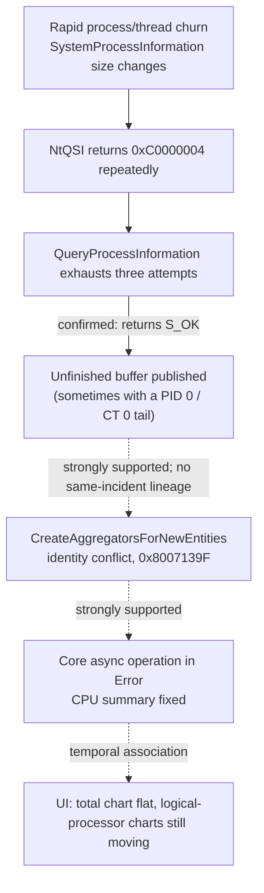
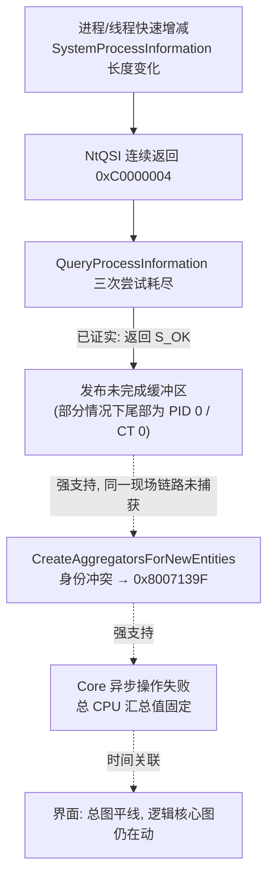

The English version governs.

<a id="en"></a>

# Task Manager CPU flatline: 21 October 2026 incident and evidence status

**English** · [中文](#zh)

English is the controlling text.

Reviewed 21 October 2026. This revises an external investigation draft written by another AI session (Antigravity) against the retained evidence. It is an independent technical assessment for the existing [Feedback Hub report](https://aka.ms/AA13rk15), not a Microsoft acknowledgement or a claim that every visually flat CPU chart has the same cause. The [consolidated evidence review](investigation-status.md) remains the reference for historical findings.

## Conclusion

1. **Confirmed defect.** `QueryProcessInformation` in `TaskManagerDataLayer.dll` returns `S_OK` and publishes an unfinished buffer when all three NtQuerySystemInformation calls report a length mismatch, and rejects a successful third call as `E_OUTOFMEMORY`. Original-function execution confirms this for component-store versions 10.0.26100.9278 and 10.0.26100.9549.
2. **Strongly supported mechanism.** Historical aggregation-error dumps contain a final PID 0 / CreateTime 0 entry and reach the identity-conflict branch of `CreateAggregatorsForNewEntities` with `0x8007139F`. A frozen-state dump pair shows a fixed CPU summary while independent CPU data still changes.
3. **Open causal chain.** No single incident has a captured continuous address lineage from an anomalous query buffer through conversion and cache publication to aggregation failure and a frozen chart.
4. **The 21 October incident is a visual flatline with successful recovery.** It does not by itself prove the defect caused that flatline.



Solid edges are verified; dashed edges are supported but not closed within one incident.

## Symptom

The CPU summary card and the total CPU chart stop drawing new samples and keep a horizontal tail. The 32 logical-processor charts and the measured system CPU continue to change. Users may read the flat line as an idle or hung system, even during heavy load.

## 21 October incident

| Property | Value |
|---|---|
| Evidence | `D:\TaskmgrFreezeCaptures\restart-20261021-155302-941920\` |
| Taskmgr | PID `89032`, OS build 10.0.26100.9549 |
| Classification | `restart_only`; no debugger attached, no `0x8007139F` dump |
| ETW attribution | `unproven` |

An Antigravity session ran generated load scripts around this time, including `sustained_churn.py` (four thread-burst workers creating 25 threads of about 5 ms per round, plus one `cmd /d /c exit` roughly every 50 ms). The capture does not record which script was running at 15:52, so the load cannot be attributed precisely.

### Timeline (`observation.json`, BST, UTC+1)

| Time | State | Flat seconds | Tail height | Tail spread | Core change | System CPU |
|---|---|---:|---:|---:|---:|---:|
| 15:52:30.85 | `normal` | — | — | — | 0.046 | — |
| 15:52:32.85 | `candidate` | 0.0 | 42.0 | 0.0 | 0.047 | 14.7% |
| 15:52:40.88 | `candidate` | 8.0 | 42.0 | 0.0 | 0.046 | 9.8% |
| 15:52:52.93 | `candidate` | 20.1 | 42.0 | 0.0 | 0.042 | 7.3% |
| 15:53:02.94 | `suspect` (confirmed) | 30.1 | 42.0 | 0.0 | 0.041 | 10.6% |

Normal samples do not record tail height or system CPU, shown as "—". A single-sample `candidate` at 15:51:08 returned to normal at the next sample. The saved chart crops (`00-total.png`, `30-total.png`) are about 100×60 pixels; they illustrate the symptom but are too small to prove a horizontal tail by eye.

### Recovery (`event.json`)

| Step | Result |
|---|---|
| ETW snapshot before recovery | 0.875 s wait (2 s limit); 1.89 s recording gap |
| Recovery start | 15:53:03.82; PID 89032 ended without force |
| New instance | PID 85352, launched in 2.3 s |
| Navigation to logical processors | 7.2 s; `logical_graphs: 32` |
| Finished | 15:53:13.75 |

### Companion ETW activity (`incident-analysis.md`)

| Phase | Duration | Thread starts (normal control) | Process starts (normal control) |
|---|---:|---:|---:|
| Before first flat observation | 2.0 s | 8,648 (8,726) | 50 (48) |
| After first flat observation | 30.1 s | 132,585 (66,794) | 766 (390) |

No events or buffers were lost; circular overwrite occurred. Most thread starts are unresolved. The transition window shows no excess over its control; the confirmation window roughly doubles. ETW cannot see Taskmgr's NtQSI statuses, buffer sizes or HRESULTs, so this is temporal association only.

**This incident shows that the visual predicate fired under load and recovery completed. It is not a reproduction of the native defect.**

## Defect evidence

### Original function against the real kernel (9549)

An isolated child loaded the System32 DLL (SHA-256 `0cc75ace…3867`) and hooked only its own NtQSI import, forwarding to the real ntdll. Load: six threads running `cmd /d /c exit` for 30 seconds. No external Taskmgr was touched and no elevation was used. Source: `.local/work-inbox/20261021-reproduce-churn-9549/churn-30s.json`.

| Path | Result | Count |
|---|---|---:|
| Two calls (mismatch, success) | `S_OK` | 1,331 |
| Three calls (mismatch, mismatch, success) | `E_OUTOFMEMORY` | 61 |
| Three calls, all `0xC0000004` (exhausted) | `S_OK` | 1 |

The exhausted query used lengths `0/1777600`, `1777664/1780512`, `1781760/1782592`, published 1,785,856 bytes with 626 records, and ended at offset 1781704 with `PID 0, CreateTime 0, NextEntryOffset 0`. Observer overhead and generated load change call timing, so the counts are not natural rates.

### Controlled synthetic returns (9549)

A separate run (`.local/work-inbox/20261021-native-9549/`) replaced the child's NtQSI import with synthetic results: mismatch then success returned `S_OK`; two mismatches then success returned `E_OUTOFMEMORY`; three mismatches returned `S_OK` with 16,384 bytes; mismatch then access denied returned `E_ACCESSDENIED`. The zero-identity tail in that case was supplied by the mock and is not kernel evidence.

### Control flow (9278 disassembly, `.local/address-chain-20261007/flow.txt`)

```text
; function RVA 0x46158 (9549: 0x4BCA8)
+0x5e  (0x461B6)  mov  eax, r14d        ; eax = old counter
                  inc  r14d             ; r14d = new counter
                  cmp  eax, 3
                  jae  +0x1cd           ; old counter >= 3 -> exit check
...
+0x193 (0x462EB)  jae  +0x1cd           ; NtQSI success also reaches the exit check
...
+0x1cd (0x46325)  cmp  r14d, 3          ; 9549: 0x4BE75
                  jne  +0x1ee           ; only counter == 3 is rejected
+0x1dd (0x46335)  call vector::_Tidy
                  mov  eax, 8007000Eh   ; E_OUTOFMEMORY
+0x1ee (0x46346)  ...                   ; publish buffer, return success (9549: 0x4BE96)
```

After three mismatches the loop leaves at old counter 3 with `r14d = 4`, so the exit check passes and the buffer is published with `S_OK`. A successful third call leaves `r14d = 3` and is rejected. A fix must accept a snapshot on actual query success and refuse to publish on exhaustion; changing only the exit to `>= 3` would still reject a successful third call. The 20 October comparison found 137 of 154 instructions byte-identical between 9278 and 9549, with the other 17 differing only in external call, import or data operands.

### Address map, 9278 to 9549

| # | 9278 | 9549 | Bytes | Role |
|:-:|:-:|:-:|:-:|---|
| 1 | `0x46158` | `0x4BCA8` | `48895c2408` | `QueryProcessInformation` entry |
| 2 | `0x461EC` | `0x4BD3C` | `8bc8` | NtQSI return site |
| 3 | `0x46325` | `0x4BE75` | `4183fe03` | Exit counter check |
| 4 | `0x4638C` | `0x4BEDC` | `488b4c2440` | Function exit |
| 5 | `0x0B4A0` | `0x0B450` | `48895c2410` | `ConvertFrom` |
| 6 | `0x0A600` | `0x0A590` | `48895c2418` | PDU2 copy constructor |
| 7 | `0x07450` | `0x074A0` | `8b02` | PDU2 move constructor |
| 8 | `0x0AC50` | `0x0ABF0` | `48895c2408` | PDU2 assignment |
| 9 | `0x08090` | `0x08130` | `48895c2410` | PDU2 destructor |
| 10 | `0x0DD80` | `0x0DD30` | `c70105000000` | PDU2 default constructor |
| 11 | `0x1966C` | `0x1A3FC` | `4053` | Byte vector `_Tidy` |
| 12 | `0x34C00` | `0x39460` | `4c8b4108` | Hash map `_Swap_val` |
| 13 | `0x42A9D` | `0x48921` | `33c0` | `GetProcessList` |
| 14 | `0x3E484` | `0x43384` | `48895c2408` | `CreateAggregatorsForNewEntities` entry |
| 15 | `0x3E5CF` | `0x434D3` | `488d4de0` | Identity-conflict branch (`0x8007139F`) |

On 21 October all fifteen 9549 signatures were re-read from the on-disk System32 DLL (SHA-256 `0cc75ace…3867`, all in `.text`) and matched. Several signatures are two to four bytes long, so a match confirms the pinned bytes, not the semantic role of each site; the roles come from the earlier address-chain work. The 9278 column was not re-read because that binary is no longer installed. Product debugger hash and byte guards remain pinned to 9278.

### Downstream effect (historical, from the consolidated review)

- Eleven aggregation-origin dumps contain real Idle and a final PID 0 / CreateTime 0 entry; a representative conflict was verified. These are error-site dumps, not eleven crashes.
- A frozen-state dump pair shows the Core async action in Error, the summary fixed at `14.058286822726798`, while independent CPU data and the sampling ring advance. A failed async operation is not evidence that its worker thread died.
- Error handling must distinguish an inner HRESULT return from Core's later throw; it is not one exception passing uncaught through every layer.

### Counterexamples and limits

- In the historical original-function experiment, 11 exhausted queries returned `S_OK`; 7 had zero-identity tails and 4 did not.
- Live query Q456 had three mismatches, counter 4 and `S_OK`, yet its tail was PID 5172 with a nonzero creation time, and no conflict was captured.
- Only component-store versions 9278 and 9549 were examined; no claim is made for other builds.
- Matching identity fields and close timestamps do not establish same-incident lineage.

## Mitigation (`FlatlineWatch`)

- **Detection:** the total CPU chart tail has zero spread and constant height for 30 seconds while logical-processor charts still change. This is a visual predicate, not a native diagnosis.
- **Recovery:** Taskmgr is restarted without force and navigated back to Performance, CPU, logical processors.
- **Light ETW (`--light-etw`):** a 64 MiB circular process/thread session is saved on confirmation and analysed offline into a bilingual companion-activity report. The accumulated storage budget is configurable (40 GiB on this workstation); a blocked budget does not stop recovery.
- A static fix alone would not prove every visual failure resolved, so the watcher should not be retired automatically.

## Verification of this revision

- Fifteen 9549 RVA signatures re-read from the on-disk DLL: all matched.
- `tools\ci-local.ps1`: 122 unit tests passed; `compileall` passed.
- The 9278 bytes, the historical dump findings and the Q456 record were taken from retained documentation and not re-examined for this revision.

## Corrections to the external draft

The draft claimed an end-to-end reproduction from a visual-only incident; quoted assembly that does not exist in the binary (a `jl` loop branch and an "EAX keeps S_OK" explanation); stated that an uncaught exception permanently suspends the timer; filled missing normal-sample fields with zeroes; described the load as pure micro-threads; extended the scope to all later 26100 servicing builds; called the condition a deadlock; and attributed earlier AI sessions' failures to unverified causes. These are corrected or removed above.

## Next steps

- Capture same-incident lineage from buffer to freeze.
- Live query tracing on 9549, separately authorised.
- Repeated incident and normal-control comparisons.

---

<a id="zh"></a>

# 任务管理器 CPU 平线：2026 年 10 月 21 日事件与证据现状

[English](#en) · **中文**

以英文为准。复核日期为 2026 年 10 月 21 日。本文依据保留证据，修订另一 AI 会话（Antigravity）写的外部调查草稿。它是对已有反馈中心报告的独立技术判断，不代表微软确认，也不宣称所有 CPU 平线现象都由同一原因造成。历史结论仍以[统一证据摘要](investigation-status.md#zh)为准。

## 结论

1. **缺陷已证实。** 三次 NtQuerySystemInformation 都返回长度不足时，`TaskManagerDataLayer.dll` 的 `QueryProcessInformation` 仍返回 `S_OK` 并发布未完成的缓冲区；第三次调用真正成功时反而返回 `E_OUTOFMEMORY`。组件版本 9278 和 9549 都已用原函数执行验证。
2. **机制有强支持。** 历史聚合错误转储的输入末尾有 PID 0 / CreateTime 0 记录，并在 `CreateAggregatorsForNewEntities` 的身份冲突分支报出 `0x8007139F`。冻结后的双转储显示总 CPU 汇总值固定，独立 CPU 数据仍在变化。
3. **因果链未闭合。** 尚未在同一次现场捕获从异常查询缓冲区经转换、缓存发布到聚合失败和图表冻结的连续地址链路。
4. **10 月 21 日事件只是视觉平线并成功恢复**，单凭它不能证明是该缺陷造成。



实线表示已验证，虚线表示有证据支持但未在同一现场闭合。

## 现象

CPU 概览卡片和总 CPU 图不再绘制新采样，尾部保持水平。32 个逻辑处理器图和实测系统 CPU 仍在变化。用户会误以为系统空闲或卡死，高负载时也是如此。

## 10 月 21 日事件

| 项目 | 内容 |
|---|---|
| 证据目录 | `D:\TaskmgrFreezeCaptures\restart-20261021-155302-941920\` |
| 任务管理器 | PID `89032`，系统构建 10.0.26100.9549 |
| 分类 | `restart_only`；未挂调试器，没有 `0x8007139F` 转储 |
| ETW 归因 | `unproven` |

Antigravity 会话在这段时间运行过测试负载脚本，包括 `sustained_churn.py`（4 个线程突发 worker，每轮创建 25 个约 5 ms 的线程；另有 1 个约每 50 ms 一次的 `cmd /d /c exit`）。现场没有记录 15:52 运行的是哪个脚本，负载无法精确归属。

### 时序（`observation.json`，英国夏令时 UTC+1）

| 时间 | 状态 | 平线秒数 | 尾部高度 | 尾部波动 | 核心变化率 | 系统 CPU |
|---|---|---:|---:|---:|---:|---:|
| 15:52:30.85 | `normal` | — | — | — | 0.046 | — |
| 15:52:32.85 | `candidate` | 0.0 | 42.0 | 0.0 | 0.047 | 14.7% |
| 15:52:40.88 | `candidate` | 8.0 | 42.0 | 0.0 | 0.046 | 9.8% |
| 15:52:52.93 | `candidate` | 20.1 | 42.0 | 0.0 | 0.042 | 7.3% |
| 15:53:02.94 | `suspect`（确认） | 30.1 | 42.0 | 0.0 | 0.041 | 10.6% |

正常样本不记录尾部高度和系统 CPU，用"—"表示。15:51:08 有一次单样本 `candidate`，下一样本即恢复正常。保存的图表截图（`00-total.png`、`30-total.png`）约 100×60 像素，只能示意现象，分辨率不足以凭肉眼证明尾部完全水平。

### 恢复（`event.json`）

| 步骤 | 结果 |
|---|---|
| 恢复前 ETW 快照 | 等待 0.875 秒（上限 2 秒）；记录断档 1.89 秒 |
| 开始恢复 | 15:53:03.82，非强制结束 PID 89032 |
| 新实例 | PID 85352，启动 2.3 秒 |
| 导航回逻辑处理器视图 | 7.2 秒，`logical_graphs: 32` |
| 完成 | 15:53:13.75 |

### ETW 伴随活动（`incident-analysis.md`）

| 阶段 | 时长 | 线程启动（正常对照） | 进程启动（正常对照） |
|---|---:|---:|---:|
| 首次平线前 | 2.0 秒 | 8,648（8,726） | 50（48） |
| 首次平线后 | 30.1 秒 | 132,585（66,794） | 766（390） |

事件和缓冲区丢失均为 0，发生过循环覆盖；大部分线程启动无法解析归属。转变窗口与对照基本持平，确认期间约为对照的两倍。ETW 看不到任务管理器的 NtQSI 返回值、缓冲区大小或 HRESULT，只是时间上的关联。

**本次事件只说明视觉判定在负载期间触发、恢复正常完成，不是原生缺陷的复现。**

## 缺陷证据

### 原函数对真实内核（9549）

独立子进程加载 System32 下的 DLL（SHA-256 `0cc75ace…3867`），只挂接本进程的 NtQSI 导入槽并转发给真实 ntdll。负载为 6 线程 `cmd /d /c exit`，持续 30 秒。未触碰外部任务管理器，未提权。来源：`.local/work-inbox/20261021-reproduce-churn-9549/churn-30s.json`。

| 路径 | 结果 | 次数 |
|---|---|---:|
| 2 次调用（不足 → 成功） | `S_OK` | 1,331 |
| 3 次调用（不足 → 不足 → 成功） | `E_OUTOFMEMORY` | 61 |
| 3 次调用均为 `0xC0000004`（耗尽） | `S_OK` | 1 |

那次耗尽查询的长度依次为 `0/1777600`、`1777664/1780512`、`1781760/1782592`，发布 1,785,856 字节、626 条记录，偏移 1781704 处尾记录为 `PID 0, CreateTime 0, NextEntryOffset 0`。观察开销与人为负载会改变调用间隔，次数不代表自然发生率。

### 合成返回值受控验证（9549）

另一次运行（`.local/work-inbox/20261021-native-9549/`）把子进程的 NtQSI 导入换成合成结果：不足后成功返回 `S_OK`；两次不足后成功返回 `E_OUTOFMEMORY`；三次不足返回 `S_OK` 并发布 16,384 字节；不足后拒绝访问返回 `E_ACCESSDENIED`。该用例的零身份尾记录由模拟提供，不是内核证据。

### 控制流

9278 实测反汇编和逐条说明见英文区，来源为 `.local/address-chain-20261007/flow.txt`。三次不足后，循环在旧计数 3 处退出，此时 `r14d = 4`，出口检查放行，缓冲区以 `S_OK` 发布。第三次成功时 `r14d = 3`，被拒为内存不足。修复应依据实际查询成功状态接受快照，耗尽时拒绝发布；只把出口改成"大于等于 3"仍会误拒第三次成功。10 月 20 日的比对显示，9278 与 9549 的 154 条指令中 137 条字节相同，其余 17 条只有外部调用、导入或数据操作数不同。

### 地址映射

15 处 9278 → 9549 地址表见英文区。10 月 21 日从磁盘上的 System32 DLL（SHA-256 `0cc75ace…3867`，全部位于 `.text`）重新读取 9549 的 15 处特征字节，全部吻合。部分特征只有 2～4 字节，吻合只证明锁定字节一致，各处的语义作用来自先前的地址链工作。9278 一列未重读，因为该版本已不在本机。产品调试器的哈希和字节保护仍锁定 9278。

### 下游影响（历史证据，转引统一证据摘要）

- 十一份聚合错误现场转储都有真实 Idle 和末尾 PID 0 / CreateTime 0 记录，代表现场已核对冲突。这些是报错现场转储，不是十一次崩溃。
- 冻结后的双转储显示 Core 异步操作处于 Error，汇总值固定为 `14.058286822726798`，同期独立 CPU 数据与采样环继续推进。异步操作失败不等于承载线程死亡。
- 异常处理须区分内层返回 HRESULT 与 Core 之后再次抛出，不能说成同一个异常全程未被捕获。

### 反例与边界

- 历史原函数实验中，11 次耗尽都返回 `S_OK`，其中 7 次有零身份尾记录，4 次没有。
- 活体查询 Q456 三次不足、计数到 4、返回 `S_OK`，但尾记录是 PID 5172、创建时间非零，也没有捕获到冲突。
- 只核对过组件版本 9278 和 9549，不外推到其他构建。
- 身份字段一致、时间相近都不足以证明同一现场的来源链。

## 缓解措施（`FlatlineWatch`）

- **判定：** 总 CPU 图尾部波动为 0、高度不变持续 30 秒，同时逻辑处理器图仍在变化。这是视觉判定，不是原生诊断。
- **恢复：** 非强制重启任务管理器，并导航回"性能 → CPU → 逻辑处理器"。
- **轻量 ETW（`--light-etw`）：** 64 MiB 循环记录进程和线程事件，确认时落盘，离线生成双语伴随活动报告。累计存储预算可配置（本机为 40 GiB），预算受阻不影响恢复。
- 静态修复本身不能证明所有视觉故障都已消除，不应据此自动停用守护程序。

## 本次修订的验证

- 从磁盘 DLL 重读 9549 的 15 处 RVA 特征字节：全部吻合。
- `tools\ci-local.ps1`：122 项单元测试通过，`compileall` 通过。
- 9278 字节、历史转储结论和 Q456 记录转引自已保留文档，本次未重新核查。

## 对外部草稿的更正

原稿把一次仅有视觉平线的事件写成端到端复现；引用了二进制中不存在的汇编（`jl` 回跳和"EAX 残留 S_OK"的解释）；声称未处理异常使定时器永久挂起；把正常样本缺失的字段填成 0；把负载写成纯微线程；把适用范围扩大到所有后续 26100 维护版本；把故障称为死锁；并把前序 AI 会话的失败归于无法核实的原因。以上均已在本文更正或删除。

## 后续

- 在同一次现场捕获从缓冲区到冻结的来源链。
- 在 9549 上做活体查询追踪，需单独授权。
- 重复比较事件与正常对照。
