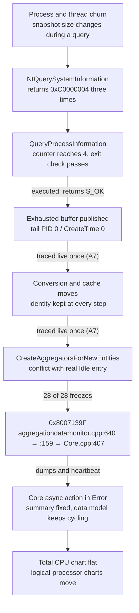
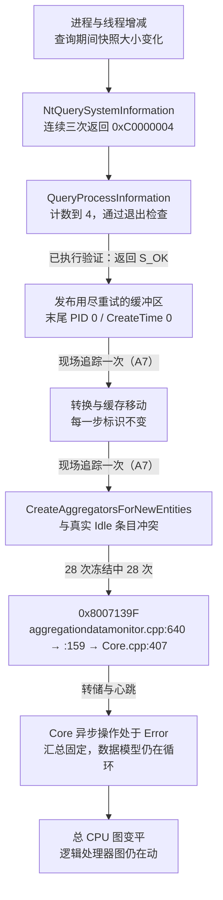

The English version governs.

# Task Manager CPU flatline: full investigation report

**English** · [中文](#zh)

English is the controlling text.

State on 1 November 2026, 23:45 UTC. This report covers the whole investigation from 29 September to 1 November 2026. It does not replace the dated documents it cites; they hold the detailed evidence. The [summary report](summary-20261101.md) gives the same result on one page.

## 1. Conclusion

1. **Cause.** `ProcessDataGenerator::QueryProcessInformation` in `TaskManagerDataLayer.dll` mishandles its retry counter. An exhausted query (three `STATUS_INFO_LENGTH_MISMATCH` results) returns `S_OK` and publishes a buffer that can end in a `PID 0 / CreateTime 0` record, and a successful third call is rejected as `E_OUTOFMEMORY`. Both are confirmed by executing the original function, on 9278 and on the current 9549 file.
2. **Path to the freeze.** In one live Task Manager under a debugger, such a `PID 0 / CreateTime 0` record was followed by address to the identity-conflict branch of `CreateAggregatorsForNewEntities`, where it collides with the genuine Idle entry; that instance then froze.
3. **Signature.** Without a debugger, every freeze whose onset could be judged (28 of 28) carries the aggregation error `0x8007139F` (`aggregationdatamonitor.cpp:640 → :159 → Core.cpp:407`), about 14 s before the flat line is visible. It has never been seen outside a freeze.
4. **Reproduction.** Thread churn provokes the freeze on demand: 9 freezes in one hour of load against 1 in one hour of quiet.
5. **Status.** Only Microsoft can fix the DLL. The watcher recovers each freeze automatically meanwhile. The problem counts as resolved only after the three goals of the [roadmap](roadmap.md) are met.

## 2. Problem and impact

- **Symptom.** On Performance > CPU the total CPU chart and the CPU summary stop at a fixed value and draw a flat line, while all 32 logical-processor charts and the measured system CPU keep changing. It lasts until Task Manager is restarted.
- **Machine.** Windows 11 Pro 25H2, build 26200.9711, 32 logical processors. `TaskManagerDataLayer.dll` 10.0.26100.9549, SHA-256 `0cc75ace…3867`, written 13 October 2026. Earlier work used 10.0.26100.9278 (`829263f5…5dce`).
- **Frequency.** From 4 October to 1 November 2026 the watcher restarted Task Manager 155 times, between 1 and 12 times a day under ordinary use; 20 on 1 November, mostly during provoked runs. Some early restarts were later shown to be idle false positives (fixed by A11). Before the provoked runs, natural freezes ran at about 0.4 per hour.
- **Why it matters.** The flat line misreports CPU load (on 24 October the line stood at about 67% while the system counter read 100%), and the defect also silently discards valid third-call snapshots about six times an hour.

## 3. Mechanism

| Step | Status | Evidence |
|---|---|---|
| Churn changes the snapshot size during a query | Supported | Provoked reproduction; cross-incident association |
| Three mismatches return `S_OK` and publish the buffer | Confirmed | Original-function execution on 9278 and 9549; real kernel and synthetic returns |
| Successful third call rejected as `E_OUTOFMEMORY` | Confirmed | Same; occurs naturally about six times an hour |
| Exhausted record reaches the identity-conflict branch | Observed once, live, under a debugger | A7 address trace |
| Conflict produces `0x8007139F` | Observed in every judged freeze | Native ETW, 28 of 28 |
| Conflict leaves the summary fixed | Supported | Frozen-state dump pair; heartbeat continues in 16 of 16 covered freezes |
| Not yet in one run | Open | Address chain and the `0x8007139F` report together; the aggregation-vector entry at the conflict |

## 4. Evidence

### 4.1 Function defect

- **Control flow.** The loop compares the old counter with 3 after the live counter has been incremented. Three mismatches leave it at 4, and the exit rejects only 3. 9549 RVAs: function `0x4BCA8`, counter loop `0x4BD06`, exit check `0x4BE75`, publication `0x4BE96`. A static comparison found 137 of 154 instructions byte-identical to 9278; the other 17 differ only in external operands. See [investigation-status](investigation-status.md).
- **Real kernel (9549).** An isolated process loaded the System32 DLL and forwarded its own `NtQuerySystemInformation` import to the kernel under `cmd` churn: mismatch then success `S_OK` 1,331 times; mismatch, mismatch, success `E_OUTOFMEMORY` 61 times; three mismatches `S_OK` once, with 626 records ending in `PID 0, CreateTime 0`. See the [21 October review](flatline-incident-20261021.md).
- **Controlled harness (J14).** `tools/verify-query-fix.py` resolves the function by public symbols and drives it with synthetic results. On 9549 it fails criteria 1 and 2 (the two defects) and passes criterion 3 (second-call success, access denied as `0x80070005`), matching the 21 October reference exactly. Receipt: `D:\TaskmgrFreezeCaptures\fix-verification\negative-control-9549-20261031-220249\`.
- **Not always a ghost record.** Exhausted queries do not always end in `PID 0 / CreateTime 0`: in the real-kernel experiment 7 of 11 did. Live query Q456 had a non-zero tail. Allocation rounds up to a 4 KiB boundary, so headroom varies from 0 to 4,095 bytes; there is no fixed reserve.

### 4.2 Native signature

- Task Manager's own TraceLogging provider `Microsoft.Windows.Taskmgr` `{2e635d8e-1107-4555-9319-32eeb895aaae}` reports failures at error level to an ordinary ETW session, without a debugger (found 25 October).
- In each freeze the frozen process logs five `FallbackError` events from `TaskManagerDataLayer.dll` with `0x8007139F` on one thread within about 1 ms: two logs, returns at `aggregationdatamonitor.cpp:640` and `:159`, then an exception at `Core.cpp:407`.
- N1 tally (`n1-summary.json`): 28 conforming, 0 non-conforming, 6 indeterminate because no normal sample preceded the flat line, 0 outside a freeze. Lead before the first flat candidate: median 13.8 s, usually 9–29 s; one of 301 s occurred while the window was minimized.
- An independent probe session (`TaskmgrWilProbe`) recorded about 80 hours up to 1 November and saw `0x8007139F` only at freezes. It was stopped on 1 November after the watcher's own records matched it across 11 freezes (J7).
- Since 26 October the watcher records this provider itself, recovers on the native error once the chart has been flat for 10 s (N3), and anchors the offline analysis on it (N2).

### 4.3 Live lineage (A7, 1 November)

- Owner-authorised run on Task Manager PID 71396 under the thread-churn load, with cdb breakpoints at 15 verified 9549 sites. The watcher was stopped while the debugger was attached.
- 23:11:43.657 UTC: query Q610 returned `S_OK` after three `0xC0000004` results, publishing 567 records with a `PID 0 / CreateTime 0` tail.
- The record was converted and then followed through assign, copy and move operations to object generation 18, keeping `PID 0 / CreateTime 0` at every step.
- 23:11:59.927 UTC: the same object reached the conflict branch (RVA `0x434D3`) against the existing Idle entry (PID 0, CreateTime 134378462553662676). A full dump was taken there.
- The watcher confirmed the same instance frozen at 23:13:56 UTC.
- In those 11 minutes: 392 normal queries, 217 third-call successes rejected as `E_OUTOFMEMORY`, 1 exhausted query.
- Not recorded: the aggregation-vector entry at the conflict, and the `0x8007139F` report itself. The debugger changes timing, so the run shows that the path exists, not how often. See [A7 lineage](a7-lineage-20261101.md).

### 4.4 Dumps

- Eleven dumps taken at the aggregation error (from 1 October) contain real Idle and a final `PID 0 / CreateTime 0` entry and reach the conflict branch. They are error-site dumps, not crashes.
- A frozen-state dump pair shows the Core async action in `Error` and the CPU summary fixed at `14.058286822726798`, while independent CPU data and the sampling ring advance. A failed async operation is not evidence of a dead thread.

### 4.5 Only the summary freezes

The data model's `CurrentUpdateCycle` events (`UpdateStarted` / `UpdateFinalized`) kept arriving about once a second until restart in every freeze with heartbeat coverage: 6 in the cross-incident table and all 10 in the provoked run.

### 4.6 Association with churn (J9)

Across 10 natural freezes with usable controls, process starts in the 2 s before the native error exceeded all 50 same-trace control windows in 6, exceeded the median in 2 more, and did not stand out in 2. Equally large bursts also occur without a freeze. Churn raises the likelihood but is neither necessary nor sufficient. See the [cross-incident table](cross-incident-20261101.md).

### 4.7 Provoked reproduction (J17)

- Round 1, `cmd.exe` churn at up to about 150 processes per second for 40 minutes of load: 1 freeze, inconclusive.
- Round 2, 4 processes creating batches of 64 short-lived threads (about 10,800 thread starts per second): 9 freezes in two 30-minute load blocks, 1 in two 30-minute quiet blocks (p ≈ 1.1%). All 10 carried the full native chain; the first came 12 s after load began.
- The recipe is now a required check for goal 2 (J19). See the [stress report](stress-reproduction-20261101.md).

### 4.8 The natural third-call rejection

`0x8007000E` at `ProcessDataSource2.cpp:821` appears about six times an hour without a freeze. Public symbols place line 821 in `ProcessDataSource3::UpdateProcessInformationList`, which calls `QueryProcessInformation` and checks its result (J8). These are the rejected third calls happening naturally.

## 5. Corrected or withdrawn claims

- A fixed 4 KiB reserve: withdrawn; headroom is 0–4,095 bytes.
- Every exhausted query yields a ghost record: withdrawn; Q456 and 4 of 11 real-kernel cases did not.
- The update thread dies, or Task Manager crashes: withdrawn; the async action fails, the data model keeps cycling, and the dumps are error-site dumps.
- The "before first flat" window precedes the freeze: withdrawn; the detector flags a candidate 11–14 s after the line went flat, so that window lay inside the freeze. Analysis is now anchored on the native error.
- A specific application causes the freeze: not supported; companion-process rankings show association only.

## 6. Timeline

| Date (2026) | Step |
|---|---|
| 29 Sep – 1 Oct | Watcher built on ScreenWatcher: visual detection, dumps, automatic restart; first debugger capture of `0x8007139F` |
| 4 Oct | Restart-only mode; Feedback Hub report AA13rk15 |
| 7 – 13 Oct | Address provenance and query tracing on 9278; local defect investigation closed on 13 October; live tracing retired |
| 13 – 23 Oct | Light ETW per incident; detector fixes for empty charts, one-pixel motion and chart widths; 9549 arrives on 13 October |
| 20 – 21 Oct | Evidence review; 9549 static comparison, real-kernel and synthetic execution |
| 25 Oct | Roadmap and critical review; native provider found; probe started |
| 26 – 27 Oct | Native recording (N2), fast recovery (N3), heartbeat (N4), coverage watchdog, blind-time retries (A8), auto-launch (A10) |
| 30 Oct | N1 passed by owner decision at 5 of 5; idle false positives fixed (A11); line 821 mapped (J8); adjustment list J1–J13 |
| 31 Oct | Owner's three goals adopted as definition of done; harness and 9549 negative control (J14); direct ETW decoder (J15) |
| 1 Nov | Cross-incident table (J9); goal automation (J16); provoked reproduction (J17); minimized-window restore and goal 2 gating (J18); daily counter fix (J20); live lineage (A7, J21) |

## 7. Mitigation in place

- **Detection.** Every 2 s a helper reads Task Manager's chart controls with `PrintWindow`. A flatline needs the newest 20% of the total chart at one pixel height for 30 s while logical charts move, or the native `0x8007139F` plus 10 s of flat chart. Empty or floor-level charts need native or system-CPU corroboration.
- **Recovery.** Close and relaunch only the frozen Task Manager, return to Performance > CPU, and verify the logical grid. Windows is never restarted.
- **Keeping watch.** Auto-launch after boot, navigation back from other pages with backoff, restore of a minimized window when the user is idle, and watchdogs for provider and heartbeat silence.
- **Evidence.** A 128 MB circular ETW session per incident (process and thread starts, the Taskmgr provider), offline analysis with retries, daily effective-hour accounting, and an N1 tally. Evidence is never deleted automatically; about 56 GB is held on D:.
- **Operational fixes along the way** include Job Object containment of analysis, a reliable retry queue, test isolation from production evidence, the realtime-consumer outage of 30 October, the decoder field loss of 1 November, and daily counters that missed confirmed freezes (J20).

## 8. Escalation

Feedback Hub report [AA13rk15](https://aka.ms/AA13rk15) exists. A corrected update with the live trace, the native signature, the reproduction recipe and the `logman` command is drafted locally and awaits the owner (A6, J12). Raw dumps and traces contain personal data from this PC and are not published.

## 9. Path to done

| Goal | Requirement | Status |
|---|---|---|
| 1 | Controlled execution shows both defects fixed in a new DLL, with the 9549 negative control | Waiting for Windows Update; runs automatically on a hash change |
| 2 | 14 days and 150 effective hours on the fixed file, at least 20 high-churn windows, 0 `0x8007139F`, 0 flatlines, and the thread-churn check passed | Not started; gated on goal 1 |
| 3 | The owner retires the watcher; the evidence and tools are kept | Standing by |

If flatlines continue on a fixed file, the visual failure has another cause and the causal work reopens.

## 10. Limits

- One machine and two DLL builds; no other hardware was tested.
- The live lineage is one instance under a debugger; natural frequency of each step is not measured.
- ETW counts process and thread starts but not exits, which also change the snapshot size.
- Visual detection cannot distinguish a freeze from a truly constant load; native corroboration addresses this only where the provider is recorded.

## 11. Where the evidence is

- **Repository:** this report, the [summary](summary-20261101.md), [roadmap](roadmap.md), [evidence review](investigation-status.md), [21 October review](flatline-incident-20261021.md), [cross-incident table](cross-incident-20261101.md), [stress report](stress-reproduction-20261101.md), [A7 lineage](a7-lineage-20261101.md), the watcher in `src/` and the tools in `tools/`.
- **`D:\TaskmgrFreezeCaptures\` (not in the repository; contains personal data):** `restart-*` incident folders, `origin-*` dumps, `a7-trace-20261101-230035\`, `stress-*`, `fix-verification\`, `wil-probe-20261025\`, `n1-summary.json`, `daily-monitoring.json`, `status.json`.
- **`.local/` (not in the repository):** working material, handover briefs and the A6 draft.

---

# 任务管理器 CPU 平线：完整调查报告

[English](#en) · **中文**

以英文为准。

截至 2026-11-01 23:45 UTC。本报告覆盖 2026-09-29 至 2026-11-01 的全部调查。它不取代所引用的各份日期文档，详细证据仍在那些文档里。[总报告](summary-20261101.md#zh)用一页给出同样的结论。

## 1. 结论

1. **原因。** `TaskManagerDataLayer.dll` 中的 `ProcessDataGenerator::QueryProcessInformation` 重试计数处理有误。查询用尽重试（三次 `STATUS_INFO_LENGTH_MISMATCH`）时返回 `S_OK`，发布的缓冲区末尾可能是一条 `PID 0 / CreateTime 0` 记录；第三次调用成功反而被判为 `E_OUTOFMEMORY`。两者都已通过直接执行原函数确认，覆盖 9278 和当前的 9549 文件。
2. **通向冻结的路径。** 在一个挂着调试器的运行中任务管理器里，这样一条 `PID 0 / CreateTime 0` 记录按地址一路追踪到 `CreateAggregatorsForNewEntities` 的标识冲突分支，在那里与真正的 Idle 条目冲突；随后该实例冻结。
3. **特征。** 不挂调试器时，每次能判定起点的冻结（28 次中 28 次）都带有聚合错误 `0x8007139F`（`aggregationdatamonitor.cpp:640 → :159 → Core.cpp:407`），比平线可见早约 14 秒；冻结之外从未出现。
4. **复现。** 线程扰动可按需诱发冻结：负载一小时 9 次，安静一小时 1 次。
5. **现状。** DLL 只能由微软修复。在此之前，监测程序自动恢复每次冻结。只有达成[路线图](roadmap.md#zh)的三个目标，问题才算解决。

## 2. 问题与影响

- **现象。** 在"性能 > CPU"页，总 CPU 图和 CPU 汇总停在一个固定值、画出一条平线，而 32 个逻辑处理器图和实测系统 CPU 仍在变化。直到重启任务管理器才恢复。
- **机器。** Windows 11 专业版 25H2，内部版本 26200.9711，32 个逻辑处理器。`TaskManagerDataLayer.dll` 10.0.26100.9549，SHA-256 `0cc75ace…3867`，写入时间 2026-10-13。早期工作用的是 10.0.26100.9278（`829263f5…5dce`）。
- **频率。** 2026-10-04 至 11-01，监测程序共重启任务管理器 155 次，日常使用下每天 1–12 次；11-01 为 20 次，大多发生在诱发测试中。早期部分重启后来证实是空闲误判（已由 A11 修正）。诱发测试之前，自然冻结约每小时 0.4 次。
- **影响。** 平线会误报 CPU 负载（10-24 那次平线停在约 67%，系统计数器为 100%）；该缺陷还会每小时约六次悄悄丢弃有效的第三次调用结果。

## 3. 机制

| 环节 | 状态 | 证据 |
|---|---|---|
| 进程增减使查询期间快照大小变化 | 有支持 | 诱发复现；跨事件关联 |
| 三次不匹配返回 `S_OK` 并发布缓冲区 | 已确认 | 9278 与 9549 原函数执行；真实内核与合成返回值 |
| 第三次调用成功被判为 `E_OUTOFMEMORY` | 已确认 | 同上；自然情况下约每小时六次 |
| 用尽重试的记录到达标识冲突分支 | 挂调试器现场观测到一次 | A7 地址追踪 |
| 冲突产生 `0x8007139F` | 每次可判定的冻结都观测到 | 原生 ETW，28 次中 28 次 |
| 冲突使汇总固定 | 有支持 | 冻结状态转储对；16 次有心跳覆盖的冻结中心跳全部继续 |
| 尚未在同一次运行中同时取得 | 未闭合 | 地址链与 `0x8007139F` 报告同时记录；冲突处的聚合向量条目 |

## 4. 证据

### 4.1 函数缺陷

- **控制流。** 循环在实时计数器已加 1 之后，才拿旧计数与 3 比较。三次不匹配后计数为 4，而退出只拒绝 3。9549 RVA：函数 `0x4BCA8`、计数循环 `0x4BD06`、退出检查 `0x4BE75`、发布 `0x4BE96`。静态比对发现 154 条指令中 137 条与 9278 逐字节相同，其余 17 条只有外部操作数不同。见[证据复核](investigation-status.md#zh)。
- **真实内核（9549）。** 独立进程加载 System32 中的 DLL，把自身的 `NtQuerySystemInformation` 导入转发到内核，同时运行 `cmd` 增减负载：不匹配后成功 `S_OK` 1,331 次；不匹配、不匹配、成功 `E_OUTOFMEMORY` 61 次；三次不匹配 `S_OK` 1 次，626 条记录，末尾为 `PID 0, CreateTime 0`。见 [10-21 事件复核](flatline-incident-20261021.md#zh)。
- **受控验证工具（J14）。** `tools/verify-query-fix.py` 用公共符号定位函数，并用合成结果驱动。在 9549 上标准 1、2（两个缺陷）不通过，标准 3（第二次调用成功；拒绝访问传播为 `0x80070005`）通过，与 10-21 参考结果完全一致。回执：`D:\TaskmgrFreezeCaptures\fix-verification\negative-control-9549-20261031-220249\`。
- **并非每次都有假记录。** 用尽重试的查询不一定以 `PID 0 / CreateTime 0` 结尾：真实内核实验中 11 次里有 7 次是。现场查询 Q456 的末尾非零。分配按 4 KiB 边界向上取整，余量在 0 到 4,095 字节之间，不存在固定余量。

### 4.2 原生特征

- 任务管理器自带的 TraceLogging 提供程序 `Microsoft.Windows.Taskmgr` `{2e635d8e-1107-4555-9319-32eeb895aaae}` 会在错误级别把故障报给普通 ETW 会话，无需调试器（10-25 发现）。
- 每次冻结时，被冻结的进程在同一线程约 1 毫秒内记录 5 条来自 `TaskManagerDataLayer.dll`、HRESULT 为 `0x8007139F` 的 `FallbackError`：两条日志，从 `aggregationdatamonitor.cpp:640` 和 `:159` 返回，最后在 `Core.cpp:407` 抛出异常。
- N1 计数（`n1-summary.json`）：符合 28 次，不符合 0 次，6 次因平线前没有正常样本而无法判定，冻结外 0 次。早于首次平线候选的时间：中位数 13.8 秒，通常 9–29 秒；有一次 301 秒，发生在窗口最小化期间。
- 独立探测会话（`TaskmgrWilProbe`）截至 11-01 共记录约 80 小时，只在冻结时出现 `0x8007139F`。监测程序自己的记录在 11 次冻结中与它一致后，于 11-01 停用（J7）。
- 自 10-26 起，监测程序自己记录该提供程序；出现原生错误且图表已平 10 秒即恢复（N3）；离线分析以它为锚点（N2）。

### 4.3 现场来源链（A7，11-01）

- 经负责人授权，在线程扰动负载下对任务管理器 PID 71396 运行，在 15 处已核验的 9549 位置设 cdb 断点。挂调试器期间监测程序停止。
- 23:11:43.657 UTC：查询 Q610 在三次 `0xC0000004` 之后返回 `S_OK`，发布 567 条记录，末尾为 `PID 0 / CreateTime 0`。
- 该记录被转换后，经赋值、复制和移动操作一路追踪到第 18 代对象，每一步都保持 `PID 0 / CreateTime 0`。
- 23:11:59.927 UTC：同一对象到达冲突分支（RVA `0x434D3`），与已有的 Idle 条目（PID 0，CreateTime 134378462553662676）冲突，并在此处取了完整转储。
- 监测程序在 23:13:56 UTC 确认同一实例冻结。
- 这 11 分钟内：正常查询 392 次，第三次调用成功被判为 `E_OUTOFMEMORY` 217 次，用尽重试 1 次。
- 未记录到：冲突处的聚合向量条目，以及 `0x8007139F` 报告本身。调试器会改变时序，因此这次运行说明这条路径存在，不说明它多常见。见 [A7 来源链](a7-lineage-20261101.md#zh)。

### 4.4 转储

- 在聚合错误处取得的 11 份转储（自 10-01 起）都含真实 Idle 和末尾的 `PID 0 / CreateTime 0` 条目，并到达冲突分支。它们是错误现场转储，不是崩溃。
- 一对冻结状态转储显示 Core 异步操作处于 `Error`，CPU 汇总固定在 `14.058286822726798`，而独立的 CPU 数据和采样环仍在前进。异步操作失败不等于线程死亡。

### 4.5 只有汇总冻结

在每次有心跳覆盖的冻结中，数据模型的 `CurrentUpdateCycle` 事件（`UpdateStarted` / `UpdateFinalized`）都约每秒一次持续到重启：跨事件表中 6 次，诱发测试中 10 次全部如此。

### 4.6 与进程增减的关联（J9）

在 10 次有可用对照的自然冻结中，原生错误前 2 秒的进程启动数有 6 次超过同一记录中全部 50 个对照窗口，另有 2 次超过对照中位数，2 次不突出。不伴随冻结时也出现同等规模的突发。进程增减提高冻结概率，但既非必要也非充分。见[跨事件表](cross-incident-20261101.md#zh)。

### 4.7 诱发复现（J17）

- 第一轮，`cmd.exe` 增减，最高约每秒 150 个进程，负载共 40 分钟：冻结 1 次，无结论。
- 第二轮，4 个进程反复成批创建 64 个短命线程（约每秒 10,800 次线程启动）：两个 30 分钟负载段冻结 9 次，两个 30 分钟安静段 1 次（p ≈ 1.1%）。10 次全部带完整原生调用链；第一次在负载开始后 12 秒出现。
- 该配方已成为目标 2 的必过检查（J19）。见[压力报告](stress-reproduction-20261101.md#zh)。

### 4.8 自然发生的第三次调用被拒

`ProcessDataSource2.cpp:821` 的 `0x8007000E` 约每小时出现六次，不伴随冻结。公共符号显示第 821 行位于 `ProcessDataSource3::UpdateProcessInformationList`，它调用 `QueryProcessInformation` 并检查返回值（J8）。这就是自然发生的第三次调用被拒。

## 5. 已更正或撤回的说法

- 固定 4 KiB 余量：撤回；余量为 0–4,095 字节。
- 每次用尽重试都会产生假记录：撤回；Q456 和真实内核实验 11 次中 4 次都没有。
- 更新线程死亡或任务管理器崩溃：撤回；是异步操作失败，数据模型仍在循环，转储是错误现场转储。
- "首次平线前"窗口位于冻结之前：撤回；检测器在线条变平 11–14 秒后才判为候选，该窗口其实落在冻结期内。分析现以原生错误为锚点。
- 某个特定程序导致冻结：没有依据；伴随进程排行只说明关联。

## 6. 时间线

| 日期（2026） | 进展 |
|---|---|
| 09-29 至 10-01 | 基于 ScreenWatcher 建成监测程序：视觉检测、转储、自动重启；首次用调试器捕获 `0x8007139F` |
| 10-04 | 仅重启模式；反馈中心报告 AA13rk15 |
| 10-07 至 10-13 | 在 9278 上做地址来源与查询追踪；10-13 本地缺陷调查结案，停用现场追踪 |
| 10-13 至 10-23 | 每次事件记录轻量 ETW；修正空图、一像素波动和图宽识别；9549 于 10-13 到达 |
| 10-20 至 10-21 | 证据复核；9549 静态比对、真实内核与合成返回值执行 |
| 10-25 | 路线图与批判性审查；发现原生提供程序；启动探测 |
| 10-26 至 10-27 | 原生记录（N2）、快速恢复（N3）、心跳（N4）、覆盖看门狗、失明重试（A8）、开机自动打开（A10） |
| 10-30 | 负责人按 5/5 判定 N1 通过；修正空闲误判（A11）；定位第 821 行（J8）；调整清单 J1–J13 |
| 10-31 | 采用负责人的三个目标作为完成标准；验证工具与 9549 负对照（J14）；直接 ETW 解码（J15） |
| 11-01 | 跨事件表（J9）；目标自动化（J16）；诱发复现（J17）；最小化还原与目标 2 门控（J18）；每日计数修复（J20）；现场来源链（A7、J21） |

## 7. 现有缓解措施

- **检测。** 每 2 秒由辅助进程用 `PrintWindow` 读取任务管理器的图表控件。判为平线需要：总图最新 20% 在同一像素高度保持 30 秒且逻辑图在动；或出现原生 `0x8007139F` 且图表已平 10 秒。空图或贴底的图需要原生错误或系统 CPU 佐证。
- **恢复。** 只关闭并重开被冻结的任务管理器，回到"性能 > CPU"，并核对逻辑处理器网格。从不重启 Windows。
- **保持监测。** 开机后自动打开；离开 CPU 页时按退避策略导航回来；用户空闲时还原最小化窗口；提供程序和心跳静默时有看门狗。
- **证据。** 每次事件一个 128 MB 循环 ETW 会话（进程与线程启动、Taskmgr 提供程序），带重试的离线分析，每日有效小时统计，以及 N1 计数。证据从不自动删除，D: 上约 56 GB。
- **过程中修复的运行问题**包括：用 Job Object 约束分析进程、可靠的重试队列、测试与生产证据隔离、10-30 实时消费者中断、11-01 解码字段丢失，以及漏计确认冻结的每日计数（J20）。

## 8. 上报

反馈中心报告 [AA13rk15](https://aka.ms/AA13rk15) 已存在。包含现场追踪、原生特征、复现配方和 `logman` 命令的修订更新已在本机起草，等负责人发布（A6、J12）。原始转储和记录含本机个人数据，不公开。

## 9. 完成路径

| 目标 | 要求 | 状态 |
|---|---|---|
| 1 | 受控执行证明新 DLL 已修复两个缺陷，并附 9549 负对照 | 等 Windows Update；哈希一变就自动执行 |
| 2 | 修复后的文件上 14 天且 150 有效小时，至少 20 个高增减窗口，0 次 `0x8007139F`，0 次平线，并通过线程扰动检查 | 未开始；须先过目标 1 |
| 3 | 负责人下线监测程序；证据和工具保留 | 待命 |

如果修复后的文件上仍出现平线，说明视觉故障另有原因，因果调查重新开启。

## 10. 局限

- 只有一台机器、两个 DLL 版本，未在其他硬件上测试。
- 现场来源链只来自挂调试器的一个实例，没有测量各环节的自然频率。
- ETW 统计进程和线程的启动，未统计退出，而退出同样改变快照大小。
- 视觉检测无法区分冻结和真正恒定的负载；只有记录了提供程序时，原生佐证才能弥补这一点。

## 11. 证据位置

- **仓库：** 本报告、[总报告](summary-20261101.md#zh)、[路线图](roadmap.md#zh)、[证据复核](investigation-status.md#zh)、[10-21 事件复核](flatline-incident-20261021.md#zh)、[跨事件表](cross-incident-20261101.md#zh)、[压力报告](stress-reproduction-20261101.md#zh)、[A7 来源链](a7-lineage-20261101.md#zh)、`src/` 下的监测程序和 `tools/` 下的工具。
- **`D:\TaskmgrFreezeCaptures\`（不入库；含个人数据）：** `restart-*` 事件文件夹、`origin-*` 转储、`a7-trace-20261101-230035\`、`stress-*`、`fix-verification\`、`wil-probe-20261025\`、`n1-summary.json`、`daily-monitoring.json`、`status.json`。
- **`.local/`（不入库）：** 工作材料、交接说明和 A6 草稿。
